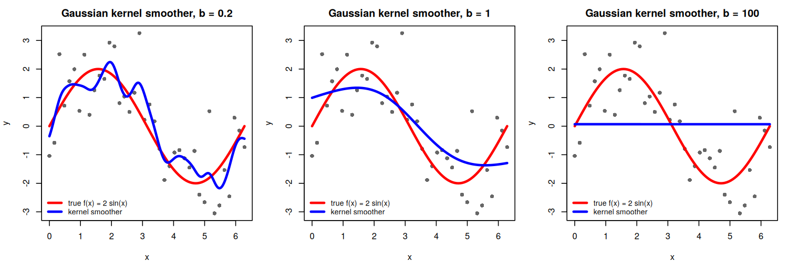

# Homework Instruction and Requirement

- Homework 5 covers course materials on **polynomial regression, nonlinearity diagnostics, and nonparametric (kernel and local) regression**.

- **MSSC 5780 students must complete all 12 questions.**

- **MATH 4780 students must complete 10 of the 12 questions.** You may choose which two questions to omit.

- Please submit your work in **one PDF file** including all parts to **D2L > Assessments > Dropbox**. Multiple files or a file that is not in PDF format are not allowed.

- In your homework, please number and answer questions **in order**.

- Your entire work on **Statistical Computing and Data Analysis** should be completed using R or your preferred statistical software and a word-processing system such as Microsoft Word, Google Docs, R Markdown, Quarto, or LaTeX. Your submitted document should be a PDF file.

- For the **Mathematical Derivation and Reasoning** question, handwritten work is allowed. If you write by hand, scan your work clearly and include it in the single PDF submission.

- It is your responsibility to make your reasoning clear. I grade your work based on **what you show, not what you intend to show**.

# Statistical Computing and Data Analysis

Please perform the analyses using $\texttt{R}$ or your preferred language. **Results should be generated by computer output, handwriting is not allowed for this section, and relevant code should be included.**

## Polynomial Regression on Rocket Propellant Data

A solid-fuel rocket propellant loses weight after it is produced. The following data are available:

| Months since Production, $x$ | Weight Loss, $y$ (kg) |
|:----------------------------:|:---------------------:|
|             0.25             |         1.42          |
|             0.50             |         1.39          |
|             0.75             |         1.55          |
|             1.00             |         1.89          |
|             1.25             |         2.43          |
|             1.50             |         3.15          |
|             1.75             |         4.05          |
|             2.00             |         5.15          |
|             2.25             |         6.43          |
|             2.50             |         7.89          |

To enter the data in R, use

```{r}
#| eval: false
rocket <- data.frame(
  x = seq(0.25, 2.5, by = 0.25),
  y = c(1.42, 1.39, 1.55, 1.89, 2.43, 3.15, 4.05, 5.15, 6.43, 7.89)
)
```

1. Fit the second-order polynomial model

   $$
   y=\beta_0+\beta_1x+\beta_2x^2+\epsilon.
   $$

   Report the fitted equation. Then test

   $$
   H_0:\beta_2=0
   \qquad\text{versus}\qquad
   H_1:\beta_2\ne0
   $$

   at $\alpha=0.05$, and comment on the need for the quadratic term in this model.

2. Are there any potential hazards in extrapolating with this model? Explain, for example, what the model would predict at $x=5$ months, or near $x=0$.

3. Compute the R-student residuals for the second-order model. Plot them against the fitted values and against $x$, and produce a normal Q-Q plot.

   Analyze the residuals and comment on the adequacy of the model.

4. Let $z=x-\bar x$ be the centered predictor, and fit the second-order model

   $$
   y=\beta_0+\beta_1z+\beta_2z^2+\epsilon.
   $$

   a. Compare the fitted coefficients, $R^2$, and fitted values with those of the model in Question 1. Which quantities change and which do not?

   b. Find the correlation between $x$ and $x^2$, and the correlation between $z$ and $z^2$. Which one is larger?

5. This question uses **unit normal scaling** to study ill-conditioning in both models.

   a. Construct the scaled design matrix $\mathbf W=\begin{bmatrix}\mathbf w_1&\mathbf w_2\end{bmatrix}$ for the model in Question 1, where for each $i=1,\dots,n$,

      $$
      w_{1i}=\frac{x_i-\bar x}{s_x},
      \qquad
      w_{2i}=\frac{d_i-\bar d}{s_d},
      \qquad
      d_i=x_i^2,
      $$

      and $s_x$ and $s_d$ are the sample standard deviations of the $x_i$'s and the $d_i$'s. Construct the corresponding matrix for the centered model in Question 4, using $z$ in place of $x$.

   b. For each model, compute

      $$
      \mathbf\Sigma=\frac{\mathbf W'\mathbf W}{n-1},
      $$

      which is the correlation matrix of the two predictors. Which model has the higher correlation between predictors? Confirm that your answer agrees with Question 4(b).

   c. Compute $\mathbf\Sigma^{-1}$ for each model. The diagonal elements of $\mathbf\Sigma^{-1}$ are the variance inflation factors and measure the degree of ill-conditioning. Does centering $x$ help alleviate the ill-conditioning problem? Explain.

## Nonlinearity Diagnostics on Prestige Data

Consider the Canadian occupational-prestige data set `Prestige` in the `carData` package (loaded automatically with `car`). Treat `prestige` as the response and `education`, `income`, and `women` as the three predictors, where

- `prestige`: Pineo-Porter prestige score for the occupation,
- `education`: average education of occupational incumbents (years),
- `income`: average income of incumbents (dollars),
- `women`: percentage of incumbents who are women.

```{r}
#| eval: false
library(car)
data(Prestige)
fit_prestige <- lm(prestige ~ education + income + women, data = Prestige)
```

6. Generate the scatterplot matrix of `prestige`, `education`, `income`, and `women` (for example, using `car::scatterplotMatrix()` or `pairs()`).

   Does the plot suggest any nonlinear relationship between the response and the predictors, or among the predictors? Is the scatterplot matrix by itself sufficient for checking the linearity assumption of a multiple regression model? Explain.

7. Fit the linear regression model and plot the R-student residuals against each predictor and against the fitted values, for example with `car::residualPlots()`.

   Comment on the plots and on the curvature tests reported by `car::residualPlots()`.

8. Generate the partial residual plots (component-plus-residual plots) using `car::crPlots()`.

   Based on the plots, transform any predictors if necessary and refit the regression. Produce the partial residual plots for the refitted model and confirm whether the nonlinearity issue has been fixed. Explain your choice of transformation.

## Kernel Smoothing and Local Regression

9. Generate $n=40$ data points $\{(x_i,y_i)\}_{i=1}^{40}$ from the model

   $$
   y=f(x)+\epsilon,
   \qquad
   f(x)=2\sin(x),
   \qquad
   \epsilon\sim N(0,1),
   $$

   where the $x_i$'s are equally spaced on $[0,2\pi]$. Use `seq()` to generate the $x_i$'s and `set.seed()` so that your results are reproducible.

   Use `KernSmooth::locpoly()` with `degree = 0` and `kernel = "normal"` to fit Gaussian kernel smoothers with bandwidths $0.2$, $1$, and $100$. For each bandwidth, plot the data, the true function $f(x)$, and the fitted smoother, similar to the figure below.

```{r}
#| echo: false
#| out-width: "100%"
#| fig-align: center

```

10. Using the same data, use `locpoly()` to fit

    a. Gaussian **local linear** regressions (`degree = 1`), and

    b. Gaussian **local quadratic** regressions (`degree = 2`),

    each with bandwidths $0.2$, $1$, and $100$. Generate plots as in Question 9.

11. Use `loess()` to fit tricube **local quadratic** regressions (`degree = 2`) with span parameter $\alpha=0.2$, $0.5$, and $0.9$. Generate plots as in Question 9.

    Then comment on your plots in Questions 9–11:

    - How does the bandwidth or span control the trade-off between bias and variance?
    - What do the fits with bandwidth $100$ reduce to for `degree = 0`, `1`, and `2`? Explain why.
    - How do the methods behave near the boundaries $x=0$ and $x=2\pi$?
    - Which method and tuning parameter do you prefer for these data, and why?

# Mathematical Derivation and Reasoning

12. Suppose the predictor values $x_1,\dots,x_n$ are **equally spaced**, i.e., $x_i=a+(i-1)\delta$ for some constants $a$ and $\delta>0$. Let $z_i=x_i-\bar x$.

    a. Show that the centered values are symmetric about zero, that is, $z_{n+1-i}=-z_i$ for $i=1,\dots,n$, and conclude that

       $$
       \sum_{i=1}^n z_i=0
       \qquad\text{and}\qquad
       \sum_{i=1}^n z_i^3=0.
       $$

    b. Use part (a) to show that the sample covariance, and therefore the sample correlation, between $z$ and $z^2$ is exactly zero:

       $$
       \operatorname{corr}(z,z^2)=0.
       $$

    c. Explain how this result relates to your answers in Questions 4(b) and 5, and why the correlation between $x$ and $x^2$ is generally **not** zero when all $x_i>0$.

# Submission Checklist

Before submitting, make sure that:

- your submission is one PDF file;
- MSSC 5780 students answered all 12 questions;
- MATH 4780 students answered 10 of the 12 questions;
- computer-generated results include relevant code;
- conclusions are supported by appropriate plots or numerical evidence;
- simulations use `set.seed()` so that results are reproducible;
- mathematical derivations are readable and logically organized;
- figures have appropriate labels, titles, and legends.
