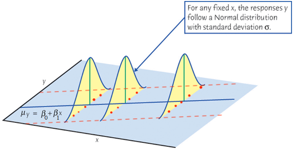

#  {visibility="hidden"}

\def\bx{\mathbf{x}}
\def\bg{\mathbf{g}}
\def\bw{\mathbf{w}}
\def\balpha{\boldsymbol \alpha}
\def\bbeta{\boldsymbol \beta}
\def\beps{\boldsymbol \epsilon}
\def\bX{\mathbf{X}}
\def\by{\mathbf{y}}
\def\bH{\mathbf{H}}
\def\bI{\mathbf{I}}
\def\bS{\mathbf{S}}
\def\bW{\mathbf{W}}
\def\T{\text{T}}
\def\cov{\mathrm{Cov}}
\def\cor{\mathrm{Corr}}
\def\var{\mathrm{Var}}
\def\E{\mathrm{E}}
\def\bmu{\boldsymbol \mu}
\DeclareMathOperator*{\argmin}{arg\,min}
\def\Trace{\text{Trace}}


```{r}
#| label: setup
#| include: false
#| eval: true
library(countdown)
library(emo)
library(knitr)
library(gt)
library(gtExtras)
library(ggplot2)
library(tidyverse)
library(tidymodels)
library(MASS)
library(car)
knitr::opts_chunk$set(
    fig.asp = 0.6,
    fig.align = "center",
    out.width = "70%",
    fig.retina = 10,
    fig.path = "./images/10-diag-linearity/",
    message = FALSE,
    global.par = TRUE
)
options(
  htmltools.dir.version = FALSE,
  dplyr.print_min = 6, 
  dplyr.print_max = 6,
  tibble.width = 80,
  width = 80,
  digits = 3
  )
hook_output <- knitr::knit_hooks$get("output")
knitr::knit_hooks$set(output = function(x, options) {
  lines <- options$output.lines
  if (is.null(lines)) {
    return(hook_output(x, options))  # pass to default hook
  }
  x <- unlist(strsplit(x, "\n"))
  more <- "..."
  if (length(lines)==1) {        # first n lines
    if (length(x) > lines) {
      # truncate the output, but add ....
      x <- c(head(x, lines), more)
    }
  } else {
    x <- c(more, x[lines], more)
  }
  # paste these lines together
  x <- paste(c(x, ""), collapse = "\n")
  hook_output(x, options)
})
par(cex = 4)
```


```{r}
#| echo: false
CIA <- read.table("./data/CIA.txt", header = TRUE)
ciafit <- lm(infant ~ gdp + health + gini, data = CIA)
r_stud <- rstudent(ciafit)
logciafit <- lm(log(infant) ~ gdp + health + gini, data = CIA)
## course data file; loaded into its own environment so nothing above is overwritten
course_data <- new.env()
load("./data/regression_datasets.rda", envir = course_data)
windmill <- course_data$windmill
```


# Model Adequacy Checking and Correction

<h2> Non-normality</h2>
<h2> Non-constant Error Variance</h2>
<h2> <span style="color:red">Non-linearity</span> and Lack of Fit </h2>

::: notes
- This deck covers two lectures. **Part I (Linearity)**: detecting nonlinearity and transforming to fix it. **Part II (Lack of Fit)**: formal and approximate tests of whether the model form is adequate, and prediction-based checks (PRESS).
- Pacing, Part I (75 min): assumptions & residual plots ~15 | AV vs. CR plots ~10 | transformations & bulging rule ~10 | intrinsically linear models & windmill ~15 | CIA transformations, effect plots ~12 | Box-Tidwell ~10 | summary ~3.
- Pacing, Part II (75 min): what is lack of fit ~5 | LOF test theory ~15 | Example 4.8 labs ~15 | near-neighbor procedure ~15 | PRESS ~15 | other methods & summary ~10.
:::

## Assumptions of Linear Regression
$Y_i= \beta_0 + \beta_1X_{i1} + \beta_2X_{i2} + \dots + \beta_kX_{ik} + \epsilon_i$

:::: {.columns}

::: {.column width="50%"}
- $E(Y \mid X)$ is linear in the regressors.
- $\small E(\epsilon_i) = 0$
- $\small \var(\epsilon_i) = \sigma^2$
- $\small \cov(\epsilon_i, \epsilon_j) = 0$ for all $i \ne j$.
- $\small \epsilon_i \sim N(0, \sigma^2)$ for exact $t$- and $F$-inference.
:::

::: {.column width="50%"}
```{r}
#| out-width: 100%

```
:::
::::


::: alert
- Assuming $E(\epsilon) = 0$ implies that the regression surface captures the dependency of the conditional mean of $y$ on the $x$s.
- Violating linearity implies that the model fails to represent the relationship between the mean response and the regressors. (Lack of fit)
:::


## Detecting Nonlinearity (CIA Example)
- Scatterplot $y$ against each $x$ can be *misleading*! It shows the **marginal** relationship between $y$ and each $x$, without controlling the level of other regressors.

```{r}
#| out-width: 70%
par(mar = c(0, 0, 0, 0))
pairs(CIA[, -5], las = 1, pch = 20, col = 4)
```


## Detecting Nonlinearity: Residual Plots
- Care about the **partial** relationship between $y$ and each $x$ with impact of other $x$s controlled.

- Residual-based plots are more relevant in detecting the departure of linearity.

. . .

:::: {.columns}

::: {.column width="30%"}
- Residual plots cannot distinguish between monotone and non-monotone non-linearity.
- The distinction:
  + Monotone: just transform $x$ to $x^2$
  + Non-monotone: need quadratic form
:::

::: {.column width="70%"}
```{r}
#| out-width: 100%
par(mfcol = c(2, 2), mar = c(2, 2, 1.5, 0), mgp = c(2, 1, 0))
set.seed(2468) # for reproducibility
x <- runif(200)
e <- rnorm(200, 0, 0.05)
y1 <- x^2 + e
y2 <- (x - 0.5)^2 + e

plot(x, y1, axes = FALSE, frame = TRUE, xlab = "", ylab = "", cex.main = 1.5,
     main = expression(paste("Monotone ", 
                             y == beta[0] + beta[1], x^2 + epsilon)), pch = 20, col = 4)
mtext("x", 1, line = 1, at = 0.95)
mtext("y", 2, line = 1, at = 0.95, las = 1)
m1 <- lm(y1 ~ x)
abline(m1, lwd = 2, col = 2)

plot(fitted(m1), residuals(m1), axes = FALSE, frame = TRUE, xlab = "", ylab = "", main = "Residual: Monotone", pch = 20, col = 4, cex.main = 1.5)
mtext(expression(hat(y)), 1, line = 1, at = 0.75)
mtext("e", 2, line = 1, at = 0.21, las = 1)
abline(0, 0, lwd = 2, col = 2)

plot(x, y2, axes = FALSE, frame = TRUE, xlab = "", ylab = "", cex.main = 1.5,
     main = expression(paste("Non-monotone ", 
                             y == beta[0] + beta[1], x + beta[2], x^2 + epsilon)), pch = 20, col = 4)
mtext("x", 1, line = 1, at = 0.96)
mtext("y", 2, line = 1, at = 0.28, las = 1)
m2 <- lm(y2 ~ x)
abline(m2, lwd = 2, col = 2)

plot(fitted(m2), residuals(m2), axes = FALSE, frame = TRUE, xlab = "", ylab = "", main = "Residual: Non-monotone", pch = 20, col = 4, cex.main = 1.5)
mtext(expression(hat(y)), 1, line = 1, at = 0.079)
mtext("e", 2, line = 1, at = 0.21, las = 1)
abline(0, 0, lwd = 2, col = 2)
```
:::
::::


::: notes
- The OLS ensures that the residuals and fitted values are uncorrelated.
:::


## What to Plot the Residuals Against

- **Fitted values $\hat{y}_i$**: nonlinearity, nonconstant variance, outliers.
  + *Not* against $y_i$: $e_i$ and $y_i$ are correlated ($r_{ey} = \sqrt{1-R^2}$), so a trend appears even when the model is correct.

. . .

- **Each regressor in the model**: nonlinearity (and nonconstant variance) in that $x_j$.
- **Regressors not in the model**: a pattern suggests that adding the regressor may improve the fit.
- **Time (collection) order**: correlated errors.

. . .

::: alert
`car::residualPlots()` plots the residuals against each regressor and $\hat{y}$, and adds a **curvature test**: the $t$ test for adding $x_j^2$ to the model (and Tukey's test for $\hat{y}^2$).
:::

::: notes
- LRA Sec 4.2.3. The $e$ vs. $y$ correlation is why we always use $\hat{y}$ on the horizontal axis.
- Tukey's test for nonadditivity: add $\hat{y}^2$ as a regressor and compare its $t$ statistic to $N(0,1)$.
:::


## [R Lab]{.pink} Residual Plots and Curvature Tests (CIA)

```{r}
#| echo: true
#| fig-asp: 0.3
#| out-width: 100%
#| code-line-numbers: false
car::residualPlots(logciafit, layout = c(1, 4), type = "rstudent")
```

- Strong curvature for `gdp`, some for `health`, none for `gini`; Tukey's test also rejects linearity.
- Next: *partial* plots tell us **which** $x$ to fix and **how**.

::: notes
- The printed table: `gdp` $t \approx 9.3$, `health` $t \approx 3.3$, `gini` $p \approx 0.5$, Tukey $t \approx 10$.
- Plotting against $x_j$ directly still mixes in the other regressors; partial residual plots isolate $x_j$.
:::


## Detecting Nonlinearity: Partial Residual Plots

- **Partial residual plots** (Component-plus-Residual Plot) are for diagnosing nonlinearity.

- The partial residuals for $x_j$: $$e_i^{(j)} = b_jx_{ij} + e_i$$ 
  + $b_j$ is the coefficient of $x_j$ in the full multiple regression
  + $e_i$s are the residuals from the full multiple regression
 
- Partial residual plot $e_i^{(j)}$ vs. $x_{ij}$ for $x_j$

::: notes
- The nonlinear pattern can be highlighted or emphasized 
- Added-variable plots, for detecting influential data, are partial plots, but they don't work well for detecting nonlinearity because they are biased towards linearity
- Cook (1993): if the regressions of x_j on the other xs are approximately linear, then the regression function in the crPlot provides a visualization of transformation.
- If the regressions among the predictors are strongly nonlinear and not well described by polynomials, then cvPlot may not be effective in recovering nonlinear partial relationships. => Use CERES plots (ceresPlots())
- And cvPlots can appear nonlinear even when the true partial regression is linear => called leakage.

:::


## Partial Regression (AV) vs. Partial Residual (CR) Plots

:::: {.columns}

::: {.column width="50%"}
**Partial regression (added-variable) plot**

- $e(y \mid x_{(j)})$ vs. $e(x_j \mid x_{(j)})$
- Slope $= b_j$; shows the *marginal contribution* of $x_j$ given the others.
- Horizontal band: $x_j$ adds no new information.
- Curvature may suggest $x_j^2$ or $1/x_j$, but the plot is *biased toward linearity*.
- Great for **influence**.
:::

::: {.column width="50%"}
**Partial residual (component-plus-residual) plot**

- $b_jx_{ij} + e_i$ vs. $x_{ij}$
- Slope $= b_j$ as well.
- Horizontal axis is $x_j$ itself, so the *shape* of the partial relationship is visible.
- Better for **nonlinearity**.
:::
::::

::: alert
Both are suggestive only: they can mislead when the $x$s are strongly correlated (multicollinearity) or strongly nonlinearly related, and they do not detect interactions.
:::

::: notes
- LRA Sec 4.2.4 (partial regression plots) and its comments: use with caution, do not detect interaction, multicollinearity can give incorrect information.
- Quick demo if time: `car::avPlots(logciafit, terms = ~ gdp)` next to `car::crPlots(logciafit, terms = ~ gdp)`; same slope, different horizontal axis.
:::


## [R Lab]{.pink} Partial Residual Plots
```{r}
#| echo: !expr c(-1)
#| fig-asp: 0.45
#| out-width: 100%
#| code-line-numbers: false
par(mar = c(2, 4, 0, 0), mgp = c(2, 1, 0), las = 1)
logciafit <- lm(log(infant) ~ gdp + health + gini, data = CIA)
# Component-plus-Residual Plot 
car::crPlots(logciafit, ylab = "partial residual", layout = c(1, 3), grid = FALSE, main = "") 
```

## Transformation for Linearity

- **Curvature that changes direction**: consider polynomial terms, e.g., $y = \beta_0 + \beta_1 x + \beta_2 x^2 + \epsilon$.
- **Monotone curvature**: consider a power transformation of $x$ (and, when justified, of $y$).
- **More complex structure**: polynomial regression (next week) or regression splines (MSSC 6250).

```{r}
#| fig-asp: 0.4
#| out-width: 100%
set.seed(4780)
x <- seq(0.2, 1, length = 200)
Ey <- (x - 0.5)^2
y <- Ey + 0.04 * rnorm(200)
par(mar = c(2, 2, 1, 0), mgp = c(2, 0.8, 0), las = 1, mfrow = c(1, 3))
plot(x, y, axes = FALSE, frame = TRUE, main = "Non-monotone, simple", 
     cex.main = 1.5, xlab = "", ylab = "", col = "darkgray", cex = 0.75)
lines(x, Ey, lwd = 2)
mtext("x", side = 1, adj = 1)
mtext("y ", side = 2, at = max(y), las = 1)

x <- seq(0, 1, length=200)
Ey <- rev(1 - x ^ 2)
y <- Ey + 0.1 * rnorm(200)
plot(x, y, axes = FALSE, frame = TRUE, main = "Monotone, simple", 
     cex.main = 1.5, xlab = "", ylab = "", col = "darkgray", cex = 0.75)
lines(x, Ey, lwd = 2)
mtext("x", side = 1, adj = 1)
mtext("y ", side = 2, at = max(y), las = 1)

x <- seq(0.02, 0.99, length = 200)
Ey <- log(x/(1 - x))
y <- Ey + 0.5 * rnorm(200)
plot (x, y, axes = FALSE, frame = TRUE, main = "Monotone, not simple", 
      cex.main = 1.5, xlab = "", ylab = "", col = "darkgray", cex = 0.75)
lines(x, Ey, lwd = 2)
mtext("x", side = 1, adj = 1)
mtext("y ", side = 2, at = max(y), las = 1)
```


::: notes
- not simple: direction of curvature changes
- Transform an $x$ rather than $y$, unless we see a common pattern of nonlinearity in the partial relationships of $y$ to many $x$s.
- Transforming $y$ changes the shape of its relationship to **all** of the $x$s, and also changes the shape of the residual distribution.
:::

## Intrinsically Linear Models

- A nonlinear function that a transformation turns into a linear one is **intrinsically** (transformably) **linear**.

$$y = \beta_0e^{\beta_1x}\epsilon \quad\Longrightarrow\quad \ln y = \ln\beta_0 + \beta_1x + \ln\epsilon \quad\Longrightarrow\quad y' = \beta_0' + \beta_1x + \epsilon'$$

. . .

::: midi
| Linearizable function | Transformation | Linear form |
|:---|:---|:---|
| $y = \beta_0x^{\beta_1}$ | $y' = \log y,\ x' = \log x$ | $y' = \log\beta_0 + \beta_1x'$ |
| $y = \beta_0e^{\beta_1x}$ | $y' = \ln y$ | $y' = \ln\beta_0 + \beta_1x$ |
| $y = \beta_0 + \beta_1\log x$ | $x' = \log x$ | $y' = \beta_0 + \beta_1x'$ |
| $y = \dfrac{x}{\beta_0x - \beta_1}$ | $y' = 1/y,\ x' = 1/x$ | $y' = \beta_0 - \beta_1x'$ |
:::

::: alert
The error must enter so that it becomes **additive** after the transformation (e.g., multiplicative $\epsilon$ for the log). LS properties then hold for the *transformed* data, not the original data.
:::

::: notes
- LRA Table 5.4 and Figure 5.4 (Daniel and Wood, 1980) show the shapes of these curves for different parameter signs.
- If $y = \beta_0e^{\beta_1x} + \epsilon$ (additive error), taking logs does not give a linear model with additive errors: then we need nonlinear regression.
:::


## [R Lab]{.pink} Windmill Data (LRA Example 5.2)

- DC output $y$ of a windmill vs. wind velocity $x$ (mph), $n = 25$.

```{r}
#| echo: true
#| code-line-numbers: false
wind_lm <- lm(dc_output ~ wind_velocity, data = windmill)
coef(wind_lm)
```

```{r}
#| fig-asp: 0.4
#| out-width: 72%
par(mfrow = c(1, 2), mar = c(3, 3.5, 2, 0.5), mgp = c(2, 0.8, 0), las = 1)
plot(windmill$wind_velocity, windmill$dc_output, pch = 16,
     xlab = "Wind velocity (mph)", ylab = "DC output", main = "Straight-line fit")
abline(wind_lm, col = 4, lwd = 2)
plot(fitted(wind_lm), rstudent(wind_lm), pch = 16, xlab = "Fitted Values",
     ylab = "R-Student Residuals", main = "Residuals")
abline(h = 0, col = 2, lwd = 2)
```

- $R^2 = 0.87$ looks good, but the residuals show clear **curvature**: the straight line is inadequate.

::: notes
- LRA: $\hat{y} = 0.1309 + 0.2411x$, $R^2 = 0.8745$, $MS_{Res} = 0.0557$.
- The data are in the course data file (`regression_datasets.rda`, object `windmill`).
:::


## [R Lab]{.pink} Windmill: Reciprocal Transformation

- A quadratic would eventually bend **down**; physics says output approaches an **upper limit** as velocity grows.
- The bulge points up and left: try $x' = 1/x$, i.e., $y = \beta_0 + \beta_1(1/x) + \epsilon$.

```{r}
#| echo: true
#| code-line-numbers: false
wind_inv <- lm(dc_output ~ I(1 / wind_velocity), data = windmill)
coef(wind_inv)
```

```{r}
#| fig-asp: 0.4
#| out-width: 72%
par(mfrow = c(1, 2), mar = c(3, 3.5, 2, 0.5), mgp = c(2, 0.8, 0), las = 1)
plot(1 / windmill$wind_velocity, windmill$dc_output, pch = 16,
     xlab = "1 / wind velocity", ylab = "DC output", main = "y vs. 1/x")
abline(wind_inv, col = 4, lwd = 2)
plot(fitted(wind_inv), rstudent(wind_inv), pch = 16, xlab = "Fitted Values",
     ylab = "R-Student Residuals", main = "Residuals")
abline(h = 0, col = 2, lwd = 2)
```

::: notes
- LRA: $\hat{y} = 2.9789 - 6.9345x'$, $R^2 = 0.98$, $MS_{Res} = 0.0089$; no strong pattern in the residuals.
- The implied curve $\hat{y} = 2.98 - 6.93/x$ has asymptote $2.98$, consistent with the physics.
- We return to these models in Part II with PRESS and the near-neighbor lack-of-fit check.
:::


## Bulging Rule for Simple Monotone Nonlinearity

:::: {.columns}

::: {.column width="50%"}

| The bulge points  | Transform  | Ladder of powers/roots  |
|:---------------:|:-------------:|:------:|
| **left**        | $x$           | **down**, e.g., $\log(x)$ |
| **right**       | $x$           |  **up** |
| **down**        | $y$           |   **down** |
| **up**          | $y$           |   **up** |


<!-- - **left**: transform $x$ **down** the ladder of powers and roots, e.g. $\log(x)$. -->

<!-- - **right**: transform $x$ **up** the ladder, e.g. $x^2$. -->

<!-- - **down**: transform $y$ **down** the ladder. -->

<!-- - **up**: transform $y$ **up** the ladder. -->

::: alert
- Prefer to transform an $x$ rather than $y$, unless we see a common pattern of nonlinearity in the partial relationships of $y$ to many $x$s.
:::


:::


::: {.column width="50%"}
```{r}
#| out-width: 100%
library(plotrix)
library(sfsmisc)
library(MASS)
par(mar = c(4, 4, 4, 4), mfrow = c(1, 1))
MASS::eqscplot(c(-.9, .9), c(-.9, .9), axes = FALSE, ann = FALSE, type = "n")
points(0, 0, cex = 2, pch = 16)

sfsmisc::p.arrows(0, 0, 0.9, 0, fill = "black")
p.arrows(0, 0, -0.9, 0, fill = "black")
p.arrows(0, 0, 0, 0.9, fill = "black")
p.arrows(0, 0, 0, -0.9, fill = "black")

plotrix::draw.arc(0, 0, radius = 0.8, lwd = 2, deg1 = 10, deg2 = 80, n = 500)
draw.arc(0, 0, radius = 0.8, lwd = 2, deg1 = 100, deg2 = 170, n = 500)
draw.arc(0, 0, radius = 0.8, lwd = 2, deg1 = 190, deg2 = 260, n = 500)
draw.arc(0, 0, radius = 0.8, lwd = 2, deg1 = 280, deg2 = 350, n = 500)

text(0.925, 0.075, labels = "x up:", xpd = TRUE, adj = 0, cex = 1.5)
text(0.925, -0.075, labels = expression(paste(x^2, ",", x^3, ",", ldots)), 
     xpd = TRUE, adj = 0, cex = 1.5)
text(-0.925, 0.075, labels = "x down:", xpd = TRUE, adj = 1, cex = 1.5)
text(-0.925, -0.075, labels = expression(paste(sqrt(x), ",", log(x), ",", ldots)), 
     xpd = TRUE, adj = 1, cex = 1.5)
text(0, 0.945, labels = "y up:", xpd = TRUE, adj = 0.5, cex = 1.5)
text(0, 1.125, labels = expression(paste(y^2, ",", y^3, ",", ldots)),
     xpd = TRUE, adj = 0.5, cex = 1.5)
text(0, -0.945, labels = "y down:", xpd = TRUE, adj = 0.5, cex = 1.5)
text(0, -1.125, labels = expression(paste(sqrt(y), ",", log(y), ",", ldots)), 
     xpd = TRUE, adj = 0.5, cex = 1.5)

z <- sqrt(0.64/2)
p.arrows(z, z, z + 0.15, z + 0.15, fill = "black")
p.arrows(z, -z, z + 0.15, -z - 0.15, fill = "black")
p.arrows(-z, z, -z - 0.15, z + 0.15, fill = "black")
p.arrows(-z, -z, -z - 0.15, -z - 0.15, fill = "black")
```
:::
::::

::: notes
Mosteller and Tukey's (1977)
- Transform an $x$ rather than $y$, unless we see a common pattern of nonlinearity in the partial relationships of $y$ to many $x$s.
- Transforming $y$ changes the shape of its relationship to **all** of the $x$s, and also changes the shape of the residual distribution.
:::


## [R Lab]{.pink} Back to CIA: Which $x$s to Transform?
::: midi
```{r}
#| echo: !expr c(-1)
#| fig-asp: 0.45
#| out-width: 100%
#| code-line-numbers: false
par(mar = c(2, 4, 0, 0), mgp = c(2, 1, 0), las = 1)
logciafit <- lm(log(infant) ~ gdp + health + gini, data = CIA)
# Component-plus-Residual Plot 
car::crPlots(logciafit, ylab = "partial residual", layout = c(1, 3), grid = FALSE, main = "") 
```
:::

::: notes
- This is the payoff of the partial residual (CR) plots and the bulging rule from earlier today: each partial plot tells us *which* $x$ to transform and *how*.
- `log(infant)` is already the response from lectures 08 and 09.
:::


## [R Lab]{.pink} Partial Residual Plots

::: midi
```{r}
#| fig-asp: 0.45
#| out-width: 100%
#| code-line-numbers: false
#| echo: true
logciafit2 <- update(logciafit, . ~ log(gdp) + poly(health, degree = 2, raw = TRUE) + gini)
car::crPlots(logciafit2, ylab = "partial residual", layout = c(1, 3), grid = FALSE, main = "") 
```
:::

::: notes
- Use `raw = TRUE` (not orthogonal polynomials) so that the coefficients refer to `health` and `health^2` directly.
- If the partial relationship of `log(infant)` to health expenditure is quadratic, its partial residual plot should be linear.
:::

## [R Lab]{.pink} Improving Model Performance
```{r}
#| echo: true
#| code-line-numbers: false
car::brief(logciafit, digits = 2)
car::brief(logciafit2, digits = 2)
```


## [R Lab]{.pink} Plotting against Original Untransformed $x$

- `logciafit2` uses `log(gdp)` and `health + health^2`, so a coefficient alone no longer describes the effect of `gdp` or `health`.
- **Effect plot**: the fitted $\log$(infant) as a function of **one** $x$ on its *original* scale, with the other $x$s held at their averages. The curve shows the shape the transformation implies.
- Points are partial residuals; the magenta line smooths them. If it follows the fitted (blue) curve, the transformation has captured the nonlinearity.

:::: {.columns}

::: {.column width="50%"}
```{r}
#| out-width: 100%
#| fig-asp: 0.5
#| code-fold: true
#| echo: true
#| code-line-numbers: false
library(effects)
par(mar = c(2, 2, 0, 0))
plot(Effect("gdp", logciafit2, residuals = TRUE), 
     lines = list(col = c("blue", "black"), lty = 2), 
     axes = list(grid = TRUE), confint = FALSE, 
     partial.residuals = list(plot = TRUE, smooth.col = "magenta", 
                              lty = 1, 
                              span = 3/4), 
     xlab = "GDP per Capita", ylab = "Partial Residual", main = "", cex.lab = 2)
```
:::

::: {.column width="50%"}
```{r}
#| out-width: 100%
#| fig-asp: 0.5
#| code-fold: true
#| echo: true
#| code-line-numbers: false
par(mar = c(2, 2, 0, 0))
plot(Effect("health", logciafit2, residuals = TRUE), 
     lines = list(col = c("blue", "black"), lty = 2), 
     axes = list(grid = TRUE), confint = FALSE, 
     partial.residuals = list(plot = TRUE, smooth.col = "magenta", 
                              lty = 1, 
                              span = 3/4),
     xlab = "Health Expenditures", ylab = "Partial Residual", main = "", cex.lab = 2)
```
:::
::::


::: notes
- Simplest call: `plot(Effect("gdp", logciafit2, residuals = TRUE))`.
- `gdp`: steep decline at low GDP that levels off, which is what `log(gdp)` implies; `health`: a curved (quadratic) effect.
- $\epsilon^{(1)}_i = f_1(x_{i1}) + e_i$ either if the partial-regression function $f_1(x_1)$ is linear after all or if the other $x$s are each linearly related to $x_1$.

- In practice, it's only strongly nonlinearly related $x$s that seriously threaten the validity of component-plus-residuals plots.

- Correlation between x1 and x2 can induce spurious nonlinearity in the CR plot for x1.

- One could correct nonlinearity one $x$ at a time, but in practice it is rarely necessary to proceed sequentially.
:::


## Transforming $x$s Analytically: Box and Tidwell (1962)

- Box and Tidwell (1962) proposed a procedure for estimating $\lambda_1, \lambda_2, \dots, \lambda_k$ in the model
$$y = \beta_0 + \beta_1x_1^{\lambda_1} + \cdots + \beta_kx_k^{\lambda_k}+ \epsilon$$

- All $x_j$s are positive.

- $\beta_0, \beta_1, \dots,  \beta_k$ are estimated *after and conditional on* the transformations.

- $x_j^{\lambda_j} = \log_e(x_j)$ if $\lambda_j = 0$.


::: notes
- If some of the xs (for instance, dummy regressors) aren't candidates for transformation, then these xs can simply enter the model linearly.
- all positive xs
:::


## [R Lab]{.pink} Box and Tidwell (1962)

Consider the model $$\log(Infant) = \beta_0 + \beta_1 GDP^{\lambda_1} + \beta_2Gini^{\lambda_2} + \beta_3 Health + \beta_4 Health ^ 2 + \epsilon$$

```{r}
#| echo: true
#| output.lines: !expr c(1:5)
#| code-line-numbers: false
car::boxTidwell(log(infant) ~ gdp + gini, 
                other.x = ~poly(health, 2, raw = TRUE), data = CIA)
```

- The point estimates are $\hat{\lambda}_1 = 0.2$ (`gdp`, close to $\log$) and $\hat{\lambda}_2 = -0.5$ (`gini`)

- The score test is for $H_0:$ no transformation is needed $(\lambda_j = 1)$.
  + Strong evidence to transform $GDP$
  + Little evidence of the need to transform the Gini coefficient


## [R Lab]{.pink} Box and Tidwell: Windmill Data

```{r}
#| echo: true
#| code-line-numbers: false
car::boxTidwell(dc_output ~ wind_velocity, data = windmill)
```

- $\hat{\lambda} \approx -0.8$, and $\lambda = 1$ (no transformation) is clearly rejected.
- The reciprocal ($\lambda = -1$) chosen from the plot and the physics is a nearby, interpretable choice.


## Summary: Part I (Linearity)

1. Scatterplots of $y$ vs. each $x$ show **marginal** relationships; use **residual-based** plots instead.
2. Plot $t_i$ vs. $\hat{y}_i$ and vs. each $x_j$; `car::residualPlots()` adds curvature tests.
3. Partial residual (CR) plots show *which* $x$ is nonlinear and the *shape* of its partial relationship.
4. Fix monotone curvature with power transformations (bulging rule, Box-Tidwell); non-monotone with polynomials.
5. Intrinsically linear models can be linearized when the error becomes additive.
6. Always refit and **recheck**.


# Part II: Lack of Fit

## What Is Lack of Fit?

- The model is $y = {\bf x}'\boldsymbol\beta + \epsilon$. If the true mean $E(y \mid {\bf x})$ is **not** of this form, the model **lacks fit**.
- Each residual mixes two things:
$$y_i - \hat{y}_i = \underbrace{\big(y_i - E(y_i)\big)}_{\text{pure error}} + \underbrace{\big(E(y_i) - \hat{y}_i\big)}_{\text{systematic (lack of fit)}}$$

. . .

- So $MS_{Res}$ estimates $\sigma^2$ **only if the model form is correct**; otherwise it is inflated by the lack of fit.
- To test the model form, we need an estimate of $\sigma^2$ that does **not** depend on the model:
  + **Replicates**: repeated $y$ at the same $x$ → exact *pure error* (formal $F$ test).
  + **Near neighbors**: points close in $x$-space → approximate pure error.

::: notes
- Residual plots (Part I) are informal; today we make the check formal.
- LRA Sec 4.5.
:::


## A Formal Test for Lack of Fit

- **Assumes** normality, independence, and constant variance; only the **straight-line form** is in doubt.
- **Requires** replicate observations of $y$ for at least one level of $x$.

. . .

- Suppose there are $m$ distinct levels $x_1, \dots, x_m$, with $n_i$ observations at $x_i$:
  + $y_{ij}$: the $j$th response at $x_i$, $\ j = 1, \dots, n_i$, $\ i = 1, \dots, m$
  + $n = \sum_{i=1}^m n_i$
  + $\bar{y}_i$: the mean of the $n_i$ responses at $x_i$

. . .

- Partition each residual:
$$y_{ij} - \hat{y}_i = (y_{ij} - \bar{y}_i) + (\bar{y}_i - \hat{y}_i)$$
- $y_{ij} - \bar{y}_i$ does not depend on the model; $\bar{y}_i - \hat{y}_i$ measures how far the line is from the local means.


## Partitioning $SS_{Res}$

Squaring and summing (the cross term vanishes because $\sum_{j}(y_{ij} - \bar{y}_i) = 0$ for each $i$):

$$\underbrace{\sum_{i=1}^m\sum_{j=1}^{n_i}(y_{ij} - \hat{y}_i)^2}_{SS_{Res},\ df = n-2} = \underbrace{\sum_{i=1}^m\sum_{j=1}^{n_i}(y_{ij} - \bar{y}_i)^2}_{SS_{PE},\ df = n-m} + \underbrace{\sum_{i=1}^m n_i(\bar{y}_i - \hat{y}_i)^2}_{SS_{LOF},\ df = m-2}$$

. . .

- $SS_{PE}$ (**pure error**): a model-independent measure of error, *if* the variance is constant.
- $SS_{LOF}$ (**lack of fit**): small when the true mean is linear, since then $\hat{y}_i \approx \bar{y}_i$.

::: notes
- Cross term: $2\sum_i(\bar{y}_i - \hat{y}_i)\sum_j(y_{ij} - \bar{y}_i) = 0$.
- Degrees of freedom: $SS_{PE}$ pools $\sum_i (n_i - 1) = n - m$; $SS_{LOF}$ has $m$ local means minus the $2$ line parameters.
- In MLR with $p$ parameters, $SS_{LOF}$ has $m - p$ df.
:::


## The Lack-of-Fit $F$ Test

$$F_0 = \frac{SS_{LOF}/(m-2)}{SS_{PE}/(n-m)} = \frac{MS_{LOF}}{MS_{PE}}$$

- $H_0$: the straight-line model is adequate. Reject if $F_0 > F_{\alpha,\, m-2,\, n-m}$.

. . .

- Why it works:
$$E(MS_{PE}) = \sigma^2, \qquad E(MS_{LOF}) = \sigma^2 + \frac{\sum_{i=1}^m n_i\big[E(y_i) - \beta_0 - \beta_1x_i\big]^2}{m-2}$$
  + If the true mean is linear, both estimate $\sigma^2$ and $F_0 \approx 1$.
  + Otherwise $MS_{LOF}$ is inflated and $F_0$ is large.

. . .

::: alert
- **Lack of fit**: abandon the model and try a different one (transformation, polynomial, extra regressors).
- **No lack of fit**: $MS_{LOF}$ and $MS_{PE}$ are combined, i.e., $MS_{Res}$ is used to estimate $\sigma^2$.
:::


## [R Lab]{.pink} Lack of Fit: LRA Example 4.8

```{r}
#| echo: true
#| code-line-numbers: false
x <- c(1.0, 1.0, 2.0, 3.3, 3.3, 4.0, 4.0, 4.0, 4.7, 5.0, 5.6, 5.6, 5.6, 6.0, 6.0, 6.5, 6.9)
y <- c(10.84, 9.30, 16.35, 22.88, 24.35, 24.56, 25.86, 29.16, 24.59, 22.25,
       25.90, 27.20, 25.61, 25.45, 26.56, 21.03, 21.46)
lof_lm <- lm(y ~ x)
```

```{r}
#| out-width: 55%
par(mar = c(3, 3, 0.5, 0.5), mgp = c(2, 0.8, 0), las = 1)
y_bar <- ave(y, x)
plot(x, y, pch = 16, cex = 1.5, xlab = "x", ylab = "y")
abline(lof_lm, col = 4, lwd = 2)
points(unique(x), tapply(y, x, mean), pch = 4, col = 2, cex = 2, lwd = 3)
segments(x, y, x, y_bar, col = "darkgray", lwd = 2)
segments(x + 0.04, y_bar, x + 0.04, fitted(lof_lm), col = 2, lwd = 3)
legend("bottomright", bty = "n", cex = 1.2,
       legend = c("LS line", "level mean", "pure error", "lack of fit"),
       col = c(4, 2, "darkgray", 2), pch = c(NA, 4, NA, NA), lty = c(1, NA, 1, 1),
       lwd = c(2, 3, 2, 3))
```

::: notes
- $n = 17$ observations at $m = 10$ distinct levels; 5 levels are replicated.
- Gray segments ($y_{ij} - \bar{y}_i$) are short; red segments ($\bar{y}_i - \hat{y}_i$) are long, so the line lacks fit (rises, then falls).
:::


## [R Lab]{.pink} Lack-of-Fit Test in R

- Pure error = residual SS of the **cell-means** model that fits a separate mean at each distinct $x$ (`factor(x)`).

```{r}
#| echo: true
#| code-line-numbers: false
pure_error_lm <- lm(y ~ factor(x))   # one mean per distinct x
anova(lof_lm, pure_error_lm)         # reduced = line, full = cell means
```

. . .

- Row 2: $SS_{LOF} = 234.57$ on $m - 2 = 8$ df, $SS_{PE} = 15.56$ on $n - m = 7$ df.
- $F_0 = 13.19$, $p = 0.0014$: strong evidence that the straight line is **inadequate**.

::: notes
- The straight line is nested in the cell-means model, so the extra-sum-of-squares $F$ test is exactly the lack-of-fit test.
- By hand: `SS_PE <- sum((y - ave(y, x))^2)`; `SS_LOF <- deviance(lof_lm) - SS_PE`.
- Multiple regression: replicates are points with identical $(x_1, \dots, x_k)$; use `lm(y ~ interaction(x1, x2, drop = TRUE))` as the cell-means model, with $df_{LOF} = m - p$.
- LRA Table 4.2 reports $SS_{LOF} = 237.34$ and $F_0 = 13.34$ because its fitted line ($13.301 + 2.108x$) is rounded; $SS_{PE} = 15.5632$ and the conclusion are the same.
:::


## [R Lab]{.pink} Does a Quadratic Fix It?

```{r}
#| echo: true
#| code-line-numbers: false
quad_lm <- lm(y ~ x + I(x^2))
anova(quad_lm, pure_error_lm)
```

```{r}
#| out-width: 45%
par(mar = c(3, 3, 0.5, 0.5), mgp = c(2, 0.8, 0), las = 1)
plot(x, y, pch = 16, cex = 1.5, xlab = "x", ylab = "y")
abline(lof_lm, col = 4, lwd = 2, lty = 2)
xx <- seq(1, 7, length.out = 200)
lines(xx, predict(quad_lm, data.frame(x = xx)), col = 2, lwd = 3)
```

- $F_0 = 2.03$ on $(7, 7)$ df, $p = 0.18$: no evidence of lack of fit for the quadratic.

::: notes
- $SS_{PE}$ is the same for every model; only $SS_{LOF}$ changes (234.6 → 31.6).
- The quadratic has $p = 3$ parameters, so $SS_{LOF}$ has $m - 3 = 7$ df. Polynomial regression is next week.
:::


## No Replicates? Estimating Error from Near Neighbors

- Points close together in $x$-space behave almost like replicates. Measure closeness by
$$D_{ii'}^2 = \sum_{j=1}^k\left[\frac{b_j(x_{ij} - x_{i'j})}{\sqrt{MS_{Res}}}\right]^2$$

. . .

- For a near-neighbor pair, $E_i = |e_i - e_{i'}|$ is the range of a sample of size 2, and $\hat{\sigma} = E/1.128 = 0.886E$.

. . .

- **Procedure** (Daniel and Wood, 1980; LRA Sec 4.5.2):
  1. Sort the data by $\hat{y}$; compute $D^2_{ii'}$ for pairs that are $1, 2, 3, 4$ positions apart ($4n - 10$ pairs).
  2. Order the pairs by $D^2_{ii'}$; let $E_u$ be the residual range of the $u$th pair.
  3. Use the $m$ closest pairs: $\displaystyle \hat{\sigma} = \frac{0.886}{m}\sum_{u=1}^m E_u$.

::: alert
Compare $\hat{\sigma}$ with $\sqrt{MS_{Res}}$: if $\sqrt{MS_{Res}}$ is much larger, the model may lack fit.
:::

::: notes
- $D_{ii'}^2$: squared distance between the fitted values contributed by the regressors, in units of $\sqrt{MS_{Res}}$.
- $1.128 = E(\text{range})/\sigma$ for two independent normal observations, so $0.886 = 1/1.128$.
- $m$ is chosen after inspecting the $D^2$ values; do not use pairs whose distance is too large.
:::


## [R Lab]{.pink} Near-Neighbor Estimate (LRA Example 4.10)

::: midi
```{r}
#| echo: true
#| code-line-numbers: false
near_neighbor_sigma <- function(fit, m) {
  X <- model.matrix(fit)[, -1, drop = FALSE]
  b <- coef(fit)[-1]; e <- residuals(fit); n <- length(e)
  ms_res <- deviance(fit) / df.residual(fit)
  o <- order(fitted(fit))
  pairs <- do.call(rbind, lapply(1:4, function(gap) {
    i <- o[1:(n - gap)]; j <- o[(1 + gap):n]
    data.frame(D2 = rowSums((sweep(X[i, , drop = FALSE] - X[j, , drop = FALSE], 2, b, "*"))^2) / ms_res,
               E = abs(e[i] - e[j]))
  }))
  pairs <- pairs[order(pairs$D2), ]
  c(sigma_nn = 0.886 * mean(pairs$E[1:m]), sqrt_MSRes = sqrt(ms_res))
}
delivery <- course_data$delivery
near_neighbor_sigma(lm(time ~ cases + distance, data = delivery), m = 15)
```
:::

- $\hat{\sigma} = 1.97$ vs. $\sqrt{MS_{Res}} = 3.26$: a hint of lack of fit (or of the influence of point 9, lecture 07).

::: notes
- This reproduces LRA Example 4.10 ($m = 15$ of the $4n - 10 = 90$ pairs).
- Try `m = 10` or `m = 20`: the estimate is fairly stable (about 2.0 to 2.2).
:::


## [R Lab]{.pink} Near Neighbors: Windmill Models

The windmill data have **no** replicates (25 distinct velocities), so the formal test is not available.

```{r}
#| echo: true
#| code-line-numbers: false
rbind(straight_line = near_neighbor_sigma(wind_lm, m = 15),
      reciprocal    = near_neighbor_sigma(wind_inv, m = 15))
```

- Straight line: $\sqrt{MS_{Res}}$ is about 3 times the pure-error estimate → **lack of fit**.
- Reciprocal: the two estimates are close → no evidence of lack of fit.


## Prediction-Based Adequacy Checking: Deleted Residuals

- The ordinary residual is
$$e_i = y_i - \hat y_i,$$
where observation $i$ was used to fit the model.

- To assess prediction for observation $i$, delete that observation, refit the model, and compute
$$e_{(i)} = y_i - \hat y_{(i)}.$$

- $e_{(i)}$ is called a **deleted residual** or **PRESS residual**.

. . .

Fortunately, we do not need to refit the model $n$ times:
$$
\boxed{e_{(i)} = \frac{e_i}{1-h_{ii}}},
$$
where $h_{ii}$ is the leverage of observation $i$.

::: alert
Deleted residuals measure leave-one-out prediction error rather than in-sample fit.
:::


## PRESS and Predicted $R^2$

The **PRESS statistic** summarizes the deleted residuals:

$$
\boxed{
\operatorname{PRESS}
= \sum_{i=1}^n e_{(i)}^2
= \sum_{i=1}^n \left(\frac{e_i}{1-h_{ii}}\right)^2
}
$$

A convenient scale-free summary is the **predicted $R^2$**:

$$
\boxed{
R^2_{\mathrm{pred}}
= 1-\frac{\operatorname{PRESS}}{SS_T},
\qquad
SS_T=\sum_{i=1}^n (y_i-\bar y)^2
}
$$

- Smaller PRESS and larger $R^2_{\mathrm{pred}}$ indicate better leave-one-out predictive performance.
- For ordinary least squares, PRESS is based on **leave-one-out cross-validation (LOOCV)**.
- Unlike ordinary $R^2$, $R^2_{\mathrm{pred}}$ evaluates how well the model predicts observations that were left out during fitting.
- $R^2_{\mathrm{pred}}$ can be negative when predictive performance is poor.

::: alert
**$R^2$:** How well does the model explain the data used to fit it?  
**$R^2_{\mathrm{pred}}$:** How well does the model predict observations not used in fitting?
:::


## [R Lab]{.pink} PRESS and Deleted Residuals

:::: {.columns}

::: {.column width="48%"}
```{r}
#| echo: true
#| code-line-numbers: false
press <- function(model) {
  e <- residuals(model)
  h <- hatvalues(model)
  e_press <- e / (1 - h)

  PRESS <- sum(e_press^2)
  y <- model.response(model.frame(model))
  SST <- sum((y - mean(y))^2)
  R2_pred <- 1 - PRESS / SST

  c(PRESS = PRESS,
    R2_pred = R2_pred,
    RMSE_LOOCV = sqrt(mean(e_press^2)))
}

rbind(
  Original = press(logciafit),
  Corrected = press(logciafit2)
)
```
:::

::: {.column width="52%"}
```{r}
#| echo: false
#| out-width: 100%
e_press <- residuals(logciafit2) / (1 - hatvalues(logciafit2))
par(mar = c(3, 3, 1, 0), mgp = c(2, 0.8, 0), las = 1)
plot(e_press, pch = 20, col = 4,
     xlab = "Observation", ylab = "PRESS residual")
abline(h = 0, lty = 2)
```
:::
::::

::: notes
- PRESS residuals are case-deletion prediction residuals, not merely another scaling of the ordinary residuals.
- Large deleted residuals identify observations that are difficult for the model to predict when they are not used in fitting.
- PRESS can be used to compare candidate regression models on predictive performance.
- Predicted $R^2$ puts PRESS on a familiar $R^2$ scale: values near 1 indicate strong predictive performance, while negative values indicate that the leave-one-out predictions are worse than simply using $\bar y$.
- Ordinary $R^2$, adjusted $R^2$, and predicted $R^2$ answer different questions and should not be expected to agree.
:::


## [R Lab]{.pink} PRESS: Comparing the Windmill Models

```{r}
#| echo: true
#| code-line-numbers: false
wind_quad <- lm(dc_output ~ wind_velocity + I(wind_velocity^2), data = windmill)
round(rbind(straight_line = press(wind_lm),
            quadratic     = press(wind_quad),
            reciprocal    = press(wind_inv)), 4)
```

- The reciprocal model predicts best ($R^2_{\mathrm{pred}} \approx 0.98$), and it also agrees with the physics.
- Interpretation: we expect the model to explain about $R^2_{\mathrm{pred}}$ of the variability in predicting **new** observations.


## Other Methods for Dealing with Nonlinearity

- Transformations of $y$ and/or $x$s, including intrinsically linear models (Part I).

. . .

- Polynomial Regression, Regression Splines or other nonparametric regression (MSSC 6250)

. . .

- A (pure) nonlinear model may be needed if the model assumptions cannot be satisfied.


## Summary: Part II (Lack of Fit)

1. Residuals = pure error + lack of fit; $MS_{Res}$ estimates $\sigma^2$ only if the model form is right.
2. **Replicates**: $SS_{Res} = SS_{PE} + SS_{LOF}$ and $F_0 = MS_{LOF}/MS_{PE}$; in R, `anova(fit, lm(y ~ factor(x)))`.
3. **No replicates**: near-neighbor estimate $\hat{\sigma} = 0.886\bar{E}$ vs. $\sqrt{MS_{Res}}$.
4. **Prediction**: PRESS and $R^2_{\mathrm{pred}}$ compare candidate models on leave-one-out prediction.
5. If the model lacks fit: transform, add terms (polynomials, next week), or move to a more flexible model.

