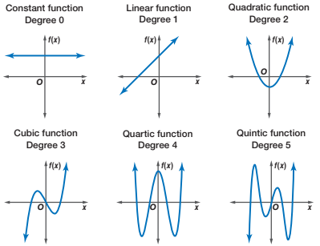
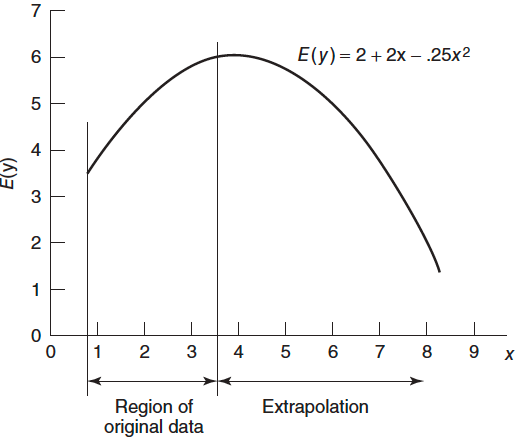

#  {visibility="hidden"}

\def\bx{\mathbf{x}}
\def\bg{\mathbf{g}}
\def\bw{\mathbf{w}}
\def\balpha{\boldsymbol \alpha}
\def\bbeta{\boldsymbol \beta}
\def\beps{\boldsymbol \epsilon}
\def\bX{\mathbf{X}}
\def\by{\mathbf{y}}
\def\bH{\mathbf{H}}
\def\bI{\mathbf{I}}
\def\bS{\mathbf{S}}
\def\bW{\mathbf{W}}
\def\T{\text{T}}
\def\cov{\mathrm{Cov}}
\def\cor{\mathrm{Corr}}
\def\var{\mathrm{Var}}
\def\E{\mathrm{E}}
\def\bmu{\boldsymbol \mu}
\DeclareMathOperator*{\argmin}{arg\,min}
\def\Trace{\text{Trace}}


```{r}
#| label: setup
#| include: false
#| eval: true
library(countdown)
library(emo)
library(knitr)
library(gt)
library(gtExtras)
library(ggplot2)
library(tidyverse)
library(tidymodels)
library(MASS)
library(car)
knitr::opts_chunk$set(
    fig.asp = 0.6,
    fig.align = "center",
    out.width = "70%",
    fig.retina = 10,
    fig.path = "./images/11-poly-reg/",
    message = FALSE,
    global.par = TRUE
)
options(
  htmltools.dir.version = FALSE,
  dplyr.print_min = 6, 
  dplyr.print_max = 6,
  tibble.width = 80,
  width = 80,
  digits = 3
  )
hook_output <- knitr::knit_hooks$get("output")
knitr::knit_hooks$set(output = function(x, options) {
  lines <- options$output.lines
  if (is.null(lines)) {
    return(hook_output(x, options))  # pass to default hook
  }
  x <- unlist(strsplit(x, "\n"))
  more <- "..."
  if (length(lines)==1) {        # first n lines
    if (length(x) > lines) {
      # truncate the output, but add ....
      x <- c(head(x, lines), more)
    }
  } else {
    x <- c(more, x[lines], more)
  }
  # paste these lines together
  x <- paste(c(x, ""), collapse = "\n")
  hook_output(x, options)
})
par(cex = 4)
```


<!-- ```{r} -->
<!-- #| echo: false -->
<!-- CIA <- read.table("./data/CIA.txt", header = TRUE) -->
<!-- ciafit <- lm(infant ~ gdp + health + gini, data = CIA) -->
<!-- r_stud <- rstudent(ciafit) -->
<!-- logciafit <- lm(log(infant) ~ gdp + health + gini, data = CIA) -->
<!-- ``` -->


# Polynomial Regression
<h2> Polynomial Models in One Variable </h2>
<h2> Orthogonal Polynomials </h2>
<h2> Piecewise Regression and Splines </h2>
<h2> Polynomial Models in Two Variables </h2>

::: notes
- Bridge: in lecture 10 we added `health^2` to the CIA model and a quadratic removed the lack of fit in LRA Example 4.8. Today: polynomial models in general.
- Pacing (75 min): why & considerations ~12 | hardwood labs (centering, model building) ~18 | orthogonal polynomials ~8 | piecewise & splines (incl. truncated power basis) ~22 | two variables ~10 | summary ~5.
:::


## Why Polynomial Regression

- Polynomials are widely used in situations where the response surface is curvilinear.
- Many complex nonlinear relationships can be adequately modeled by polynomials over reasonably small ranges of the $x$'s.

```{r}
par(mfrow = c(1, 2))
par(mar = c(2, 2, 2, 0), mgp = c(0.5, 0, 0), las = 1)
set.seed(4780)
x <- seq(-1, 1, by = 0.01)
y_qua <- 1 + x - 3 * x ^ 2 + rnorm(length(x), 0, 1)
y_cube <- 1 + x - x ^ 2 + 5 * x ^ 3 + rnorm(length(x), 0, 1)
plot(x, y_qua, xlab = "x", ylab = "y", 
     main = expression(paste("E(y|x) = 1 + x - 3", x^2)),cex.main = 2,
     pch = 16, col = 4, xaxt = "n",  yaxt = "n", cex = 0.8)
lines(x, 1 + x - 3 * x ^ 2, col = 2, lwd = 3)
plot(x, y_cube, xlab = "x", ylab = "y", cex.main = 2,
     main = expression(paste("E(y|x) = 1 + x - ", x^2 + 5*x^3)),
     pch = 16, col = 4, xaxt = "n",  yaxt = "n", cex = 0.8)
lines(x, 1 + x - x ^ 2 + 5 * x ^ 3, col = 2, lwd = 3)
```

::: notes
- They are also useful as approximating functions to unknown and possibly very complex nonlinear relationships.
- In this sense, the polynomial model is just the Taylor series expansion of the unknown function.
:::


## Polynomial Regression Models
- A **second**-order (degree) polynomial in **one** variable or a **quadratic** model is
$$y = \beta_0 + \beta_1 x + \beta_2 x^2 + \epsilon$$

- A **second**-order polynomial in **two** variables is
$$y = \beta_0 + \beta_1 x_1 + \beta_2 x_2 + \beta_{11}x_1^2 + \beta_{22}x_2^2 + \beta_{12}x_1x_2 + \epsilon$$

- The **$k$th-order** polynomial model in **one** variable is
$$y = \beta_0 + \beta_1 x + \beta_2 x^2 + \cdots + \beta_kx^k + \epsilon$$

- If we set $x_j = x^j$, this is just a multiple linear regression model with $k$ predictors $x_1, x_2, \dots, x_k$!


## Important Considerations
::: large
_Keep the order of the model **as low as possible**_.
:::

:::: {.columns}

::: {.column width="50%"}
- Transform data to keep the model 1st order.

- If fails, try a 2nd order model.

- Avoid higher-order polynomials unless they can be justified for reasons *outside the data*.

- `r emo::ji('point_right')` **Occam's Razor**: among competing models that predict equally well, choose the "simplest" one, i.e., a **parsimonious** model.
  + This avoids **overfitting** that leads to nearly perfect fit to the data, but bad prediction performance.
  
:::

::: {.column width="50%"}
```{r}
#| fig-cap: "Source: Wikiversity"

```
:::

::::
  
::: notes
There are several important considerations that arise when fitting a polynomial
in one variable.
- A low-order model in a transformed variable is almost always preferable to a high-order model in the original metric. 
- Arbitrary fitting of high-order polynomials is a serious abuse of regression analysis.
- You can always fit a polynomial model with very high order. It may give you a pretty good fit, but with very high chance, it will end up with very bad prediction, leading to overfitting.
  + **Occam's Razor**: among competing models that predict equally well, choose the "simplest" one, i.e., **parsimonious** model.
  + This avoid **overfitting** that leads to bad prediction performance.

:::

. . .

::: alert
*"Bayesian Deep Learning and a Probabilistic Perspective of Generalization"* Wilson and Izmailov (2020) for the rationale of choosing a super high-order polynomial as the regression model.
:::

::: notes
- the ground truth explanation for the data is out of class for any of these choices, but there is some setting of the coefficients in choice (3) which provides a better description of reality than could be managed by choices (1)
and (2).
- our beliefs about the generative processes for our observations, which are often very sophisticated, typically ought to be independent of how many data points we happen to observe.
- we often use neural networks with millions of parameters to fit datasets with thousands of points
:::


## Important Considerations
::: large
*Model building strategy*
:::

- `r emo::ji('point_right')` **Forward selection**: successively fit models of increasing order until the $t$-test for the highest order term is non-significant.

- `r emo::ji('point_right')` **Backward elimination**: fit the highest order model and then delete terms one at a time until the highest order remaining term has a significant $t$ statistic.

- `r emo::ji('point_right')` They do not necessarily lead to the same model.

- `r emo::ji('point_right')` Restrict our attention to low-order polynomials.

## Important Considerations
::: large
*Extrapolation*
:::

- Can be extremely dangerous when the model is higher-order polynomial. 
- The nature of the true underlying relationship may change or be completely different from the system that produced the data used to fit the model.

```{r}
#| out-width: 40%

```


## Important Considerations
::: large
*Ill-conditioning*
:::

  + **Ill-conditioning**: *as the order of the model increases, ${\bf X'X}$ matrix inversion will become inaccurate*, and error may be introduced into the parameter estimates
  + Centering the predictors may remove some ill conditioning but not all.
  + One solution is to use **orthogonal polynomials** (LRA Sec 7.5).
  
  
::: notes
  + **Ill-conditioning** refers to the fact that *as the order of the model increases, ${\bf X'X}$ matrix inversion will become inaccurate*, and error can be introduced into the parameter estimates
  + Centering the predictors may remove some ill conditioning but not all.
:::

## Important Considerations
::: large
*Hierarchy*
:::

- A **hierarchical** model of order $k$ contains **all** terms of order $k$ and below:
$$y = \beta_0 + \beta_1x + \beta_2x^2 + \cdots + \beta_kx^k + \epsilon$$

. . .

- Two schools of thought:
  + Always maintain hierarchy (keep $x$ when $x^2$ is in the model).
  + Hierarchy is not important; keep only significant terms.

. . .

::: alert
Fit the model with the significant terms, then use knowledge of the process to decide whether a hierarchical model is needed. A non-hierarchical model is **not** invariant to shifting $x$ (e.g., centering).
:::

::: notes
- Example: $y = \beta_0 + \beta_2 x^2$ becomes $\beta_0 + \beta_2 (x - c)^2 = \beta_0 + \beta_2c^2 - 2\beta_2cx + \beta_2x^2$ after a shift: a linear term reappears. That is why most analysts keep lower-order terms.
:::


## Example 7.1: [Hardwood Data](./data/data-ex-7-1.csv) (LRA)
- Strength of kraft paper vs. the percentage of hardwood in the batch of pulp from which the paper was produced.
- A quadratic model may adequately describe the relationship between tensile strength and hardwood concentration.

:::: {.columns}

::: {.column width="33%"}
```{r}
#| echo: !expr c(3)
hardwood <- read.csv(file = "./data/data-ex-7-1.csv", header = TRUE)
colnames(hardwood) <- c("conc", "strength")
hardwood[1:9, ]
```
:::

::: {.column width="66%"}
```{r}
#| out-width: 90%
par(mar = c(3.5, 3.5, 0, 0), mgp = c(2, 0.8, 0), las = 1)
par(mfrow = c(1, 1))
plot(hardwood$conc, hardwood$strength, pch = 16, 
     xlab = "Hardwood concentration %", ylab = "Tensile strength",
     xlim = c(0, 16), ylim = c(0, 60), cex.lab = 1.5, cex = 2)
```
:::
::::

## [R Lab]{.pink} Hardwood Data Model Fitting
- Following the suggestion that centering the data may remove nonessential ill-conditioning:
$$y = \beta_0 + \beta_1 (x - \bar{x}) + \beta_2 (x - \bar{x}) ^ 2 + \epsilon$$

```{r}
#| echo: true
conc_cen <- hardwood$conc - mean(hardwood$conc)
lm(strength ~ conc_cen + I(conc_cen ^ 2), data = hardwood)
```

- $\hat{y} = 45.3 + 2.55 (x - 7.26) - 0.635 (x - 7.26) ^ 2$
- Inference, prediction and residual diagnostics procedures are the same as multiple linear regression.


::: notes
- We don't need to create an extra predictor concentration ^ 2 in the data set.
- We can construct the x_sq term in the lm() function. 
- We use the I() function to wrap the operation conc_cen ^ 2, so that concen_cen ^ 2 is not interpreted as a part of formula, but actual arithmetic operation.
- To avoid this confusion, the function I() can be used to bracket those portions of a model formula where the operators are used in their arithmetic sense. For example, in the formula y ~ a + I(b+c), the term b+c is to be interpreted as the sum of b and c.
:::


## [R Lab]{.pink} Hardwood: Building the Model Order

- **Forward selection**: increase the order until the highest-order term is not significant.

```{r}
#| echo: true
#| code-line-numbers: false
fit1 <- lm(strength ~ conc, data = hardwood)
fit2 <- update(fit1, . ~ . + I(conc^2))
fit3 <- update(fit2, . ~ . + I(conc^3))
fit4 <- update(fit3, . ~ . + I(conc^4))
anova(fit1, fit2, fit3, fit4)
```

. . .

- $x^2$ and $x^3$ are significant; $x^4$ is not ($p \approx 0.23$): forward selection stops at the **cubic**.

::: question
LRA uses the quadratic ($R^2 = 0.91$); the cubic has $R^2 = 0.97$. Which would you report? What would you check first?
:::

::: notes
- Points for discussion: residual plots of the quadratic (curvature left?), the scientific meaning of the turning point, extrapolation behavior of a cubic beyond 15%, and parsimony.
- `anova()` with nested models gives the sequential extra-sum-of-squares $F$ tests ($= t^2$ for one added term).
:::


## [R Lab]{.pink} Hardwood: Quadratic vs. Cubic

```{r}
#| out-width: 60%
par(mar = c(3.5, 3.5, 0.5, 0), mgp = c(2, 0.8, 0), las = 1)
plot(hardwood$conc, hardwood$strength, pch = 16, cex = 2, cex.lab = 1.5,
     xlab = "Hardwood concentration %", ylab = "Tensile strength", xlim = c(0, 18), ylim = c(0, 60))
xx <- seq(0, 18, length.out = 200)
lines(xx, predict(fit2, data.frame(conc = xx)), col = 4, lwd = 3)
lines(xx, predict(fit3, data.frame(conc = xx)), col = 2, lwd = 3, lty = 2)
abline(v = 15, lty = 3)
legend("bottomright", c("quadratic", "cubic"), col = c(4, 2), lty = c(1, 2), lwd = 3, bty = "n", cex = 1.5)
```

- Nearly identical within the data; they **disagree beyond 15%** (dotted line): extrapolation danger.


## Orthogonal Polynomials

- Fit $y = \alpha_0P_0(x) + \alpha_1P_1(x) + \cdots + \alpha_kP_k(x) + \epsilon$, where $P_j(x)$ is a polynomial of degree $j$ and
$$\sum_{i=1}^n P_r(x_i)P_s(x_i) = 0, \quad r \ne s$$

. . .

- Then ${\bf X'X}$ is **diagonal**: no ill-conditioning, and
$$\hat{\alpha}_j = \frac{\sum_i P_j(x_i)y_i}{\sum_i P_j^2(x_i)}$$
- Adding $P_{k+1}$ does **not** change $\hat{\alpha}_0, \dots, \hat{\alpha}_k$.

. . .

- `poly(x, k)` (default) builds orthogonal polynomials; `poly(x, k, raw = TRUE)` builds $x, x^2, \dots, x^k$.
  + Same fitted values and same test for the highest-order term.
  + Coefficients of orthogonal polynomials are not directly interpretable in terms of $x$.

::: notes
- LRA Sec 7.5. Orthogonal polynomials are especially convenient when the $x$ levels are equally spaced (tabulated $P_j$).
- In lecture 10 we used `raw = TRUE` so that the coefficients refer to `health` and `health^2` directly.
:::


## [R Lab]{.pink} Orthogonal vs. Raw Polynomials

```{r}
#| echo: true
#| code-line-numbers: false
orth3 <- lm(strength ~ poly(conc, 3), data = hardwood)
raw3  <- lm(strength ~ poly(conc, 3, raw = TRUE), data = hardwood)
round(crossprod(model.matrix(orth3)), 10)     # X'X is diagonal
all.equal(fitted(orth3), fitted(raw3))         # same fit
coef(lm(strength ~ poly(conc, 2), data = hardwood))   # first 3 unchanged ...
coef(orth3)                                            # ... when P_3 is added
```


## Piecewise (Polynomial) Regression
- A polynomial regression may provide a poor fit, and increasing the order does not improve the situation.
- This may happen when *the regression function behaves differently in different parts of the range of $x$*.

. . .

- SOLUTION: `r emo::ji('point_right')` *piecewise* polynomial regression that **fits separate polynomials over different regions of $x$**.
- Example:
$$y=\begin{cases}
    \beta_{01} + \beta_{11}x+ \beta_{21}x^2+\beta_{31}x^3 +\epsilon     & \quad \text{if } x < c\\
    \beta_{02} + \beta_{12}x+ \beta_{22}x^2+\beta_{32}x^3+\epsilon      & \quad \text{if } x \ge c
  \end{cases}$$
  
- The joint points of pieces are called **knots**.

. . .

- Using more knots leads to a more flexible piecewise polynomial. 

::: question
With $K$ different knots, how many different polynomials do we have?
:::

<!-- - With $K$ different knots, we fit $K + 1$ different polynomials. -->
<!-- - Piecewise polynomials of order $k$ are called **splines**. -->

::: notes
- With $K$ knots we fit $K + 1$ different polynomials.
- There might be two different systems or schemes that govern the relationship between response and predictor variables.
- Any issue of fitting a piecewise polynomial regression?
- In other words, we fit two different polynomial functions to the data, one on the subset of the observations with $xi < c$, and one on the subset of
the observations with $xi ≥ c$. The first polynomial function has coefficients β01, β11, β21, β31, and the second has coefficients β02, β12, β22, β32. 
- Each of these polynomial functions can be fit using least squares applied to simple functions of the original predictor.
- the function is discontinuous
- locations of the knots are known, otherwise it is a nonlinear regression problem.
- WE could fit piecewise regression with order 1.
- (or more constrained?) 
:::


## [U.S. Birth Rate from 1917 to 2003](./data/birthrates.rda)
:::: {.columns}

::: {.column width="30%"}
```{r}
#| class-output: my_class800
load("./data/birthrates.rda")
head(birthrates, n = 20)
```
:::

::: {.column width="70%"}
```{r}
#| out-width: 100%
par(mar = c(3, 3.5, 0, 0), mgp = c(2, 0.8, 0))
plot(birthrates, pch = 19, col = 4, cex.lab = 1.5, cex = 1.5)
```
:::
::::


## [R Lab]{.pink} A Polynomial Regression Provides a Poor Fit
```{r}
#| echo: true
#| results: hide
lmfit3 <- lm(Birthrate ~ poly(Year - mean(Year), degree = 3, raw = TRUE),  
             data = birthrates)
```


:::: {.columns}

::: {.column width="50%"}
```{r}
#| out-width: 100%
par(mar = c(3, 3.5, 2, 0), mgp = c(2, 0.8, 0))
lmfit3 <- lm(Birthrate ~ poly(Year-mean(Year), degree = 3, raw = TRUE),  data = birthrates)
plot(birthrates, pch = 19, col = 4, main = "degree = 3", cex.lab = 1.5, cex = 1.5, cex.main = 2)
lines(birthrates$Year, lmfit3$fitted.values, lty = 1, 
      col = 2, lwd = 3)
```
:::

::: {.column width="50%"}
```{r}
#| out-width: 100%
par(mar = c(3, 3.5, 2, 0), mgp = c(2, 0.8, 0))
lmfit5 <- lm(Birthrate ~ poly(Year-mean(Year), degree = 5, raw = TRUE), data = birthrates)
plot(birthrates, pch = 19, col = 4, main = "degree = 5", cex.lab = 1.5, cex = 1.5, cex.main = 2)
lines(birthrates$Year, lmfit5$fitted.values, lty = 1, 
      col = 2, lwd = 3)
```
:::
::::


::: notes
It might be interesting to fit a linear regression with high order polynomials to approximate this curve. This can be carried out using the poly() function, which calculates all polynomials up to a certain power. Please note that this is a more stable method compared with writing out the powers such as I(Year^2), I(Year^3) etc because the Year variable is very large, and is numerically unstable.
:::


## [R Lab]{.pink} Piecewise Polynomials: 3 knots at 1936, 60, 78
```{r}
#| out-width: 65%
# par(mfrow=c(1,2))
myknots = c(1936, 1960, 1978)
bounds = c(1917, myknots, 2003)  

# # piecewise constant
# mybasis = cbind("x_1" = (birthrates$Year < myknots[1]), 
#                 "x_2" = (birthrates$Year >= myknots[1])*(birthrates$Year < mykots[2]), 
#                 "x_3" = (birthrates$Year >= myknots[2])*(birthrates$Year < mykots[3]),
#                 "x_4" = (birthrates$Year >= myknots[3]))
#     
# lmfit <- lm(birthrates$Birthrate ~ . -1, data = data.frame(mybasis))
# par(mar = c(2,3,2,0))    
# plot(birthrates, pch = 19, col = "darkorange")
# abline(v = myknots, lty = 2)
# title("Piecewise constant")
# 
# for (k in 1:4)
#     points(c(bounds[k], bounds[k+1]), rep(lmfit$coefficients[k], 2), type = "l", lty = 1, col = "deepskyblue", lwd = 4)
    
    # piecewise linear
mybasis = cbind("x_1" = (birthrates$Year < myknots[1]), 
                "x_2" = (birthrates$Year >= myknots[1])*(birthrates$Year < myknots[2]), 
                "x_3" = (birthrates$Year >= myknots[2])*(birthrates$Year < myknots[3]),
                "x_4" = (birthrates$Year >= myknots[3]),
                "x_11" = birthrates$Year*(birthrates$Year < myknots[1]), 
                "x_21" = birthrates$Year*(birthrates$Year >= myknots[1])*(birthrates$Year < myknots[2]),
                "x_31" = birthrates$Year*(birthrates$Year >= myknots[2])*(birthrates$Year < myknots[3]),
                "x_41" = birthrates$Year*(birthrates$Year >= myknots[3]))
        
lmfit <- lm(birthrates$Birthrate ~ .-1, data = data.frame(mybasis))
par(mar = c(2,3,2,0))  
plot(birthrates, pch = 19, col = 4)
abline(v = myknots, lty = 2)
title(main = list("Piecewise linear", cex = 2))

for (k in 1:4)
points(c(bounds[k], bounds[k+1]), 
       lmfit$coefficients[k] + c(bounds[k], bounds[k+1]) * lmfit$coefficients[k+4], 
       type = "l", lty = 1, col = 2, lwd = 3)
```


::: question
Any issue of piecewise polynomials?
:::

. . .

- The pieces do not join: the fitted function **jumps** at the knots.

::: notes
These functions are not continuous. Hence we use a trick to construct a continuous basis (next slide).
:::


## Making the Pieces Join: Truncated Power Basis

- Define $(x - t)_+ = \max(0,\ x - t)$.

- **Linear spline** with knots $t_1, \dots, t_K$:
$$y = \beta_0 + \beta_1x + \sum_{h=1}^K \gamma_h (x - t_h)_+ + \epsilon$$
  + Continuous at every knot; the slope **changes by $\gamma_h$** at $t_h$.

. . .

- **Cubic spline**:
$$y = \beta_0 + \beta_1x + \beta_2x^2 + \beta_3x^3 + \sum_{h=1}^K \gamma_h (x - t_h)^3_+ + \epsilon$$
  + Continuous with continuous 1st and 2nd derivatives; $K + 4$ parameters.

. . .

::: alert
For **fixed** knots, a spline is just a multiple linear regression: all the tools (LS, $t$ and $F$ tests, diagnostics) apply. Testing $H_0: \gamma_1 = \cdots = \gamma_K = 0$ asks whether the pieces are needed.
:::

::: notes
- LRA Sec 7.2.2. If the knot locations are unknown parameters, the model becomes nonlinear regression.
- `splines::bs()` uses the B-spline basis: numerically better, same column space, same fitted values.
:::


## [R Lab]{.pink} Linear Spline by Hand

```{r}
#| echo: true
#| code-line-numbers: false
#| out-width: 55%
lin_hand <- lm(Birthrate ~ Year + pmax(Year - 1936, 0) + pmax(Year - 1960, 0) +
                 pmax(Year - 1978, 0), data = birthrates)
par(mar = c(3, 3.5, 0.5, 0), mgp = c(2, 0.8, 0))
plot(birthrates, pch = 19, col = 4, cex = 1.5, cex.lab = 1.5)
lines(birthrates$Year, fitted(lin_hand), col = 2, lwd = 3)
abline(v = c(1936, 1960, 1978), lty = 2)
```

- 5 parameters instead of the 8 of the piecewise linear fit, and the pieces now **join**.


## Splines
Splines of degree $k$ are piecewise polynomials of degree $k$ with **continuity in derivatives** (smoothing) up to degree $k-1$ at each knot.

- Use `bs()` function in the **splines** package.

```{r}
#| echo: !expr c(1)
#| out-width: 55%
lin_sp <- lm(Birthrate ~ splines::bs(Year, degree = 1, knots = c(1936, 1960, 1978)), 
             data = birthrates)
par(mar = c(3, 3, 2,0)) 
plot(birthrates, pch = 19, col = 4, main = "Linear spline (k = 1) with 3 knots",
     cex.main = 2)
lines(birthrates$Year, lin_sp$fitted.values, lty = 1, col = 2, lwd = 3)
```


## Cubic Splines
- The cubic spline is a spline of degree 3 with *first 2 derivatives are continuous* at the knots.


```{r}
#| echo: !expr c(1)
#| out-width: 55%
cub_sp <- lm(Birthrate ~ splines::bs(Year, degree = 3, knots = c(1936, 1960, 1978)), 
             data = birthrates)
par(mar = c(3, 3, 2,0)) 
plot(birthrates, pch = 19, col = 4, main = "Cubic spline (k = 3) with 3 knots",
     cex.main = 2)
lines(birthrates$Year, cub_sp$fitted.values, lty = 1, col = 2, lwd = 3)
```


## [R Lab]{.pink} Are the Knots Needed?

- The cubic polynomial (`lmfit3`) is nested in the cubic spline: same cubic terms plus 3 truncated terms.

```{r}
#| echo: true
#| code-line-numbers: false
c(cubic_poly = summary(lmfit3)$r.squared, cubic_spline = summary(cub_sp)$r.squared)
anova(lmfit3, cub_sp)
```

- $R^2$ jumps from 0.42 to 0.96, and $F \approx 323$ on $(3, 80)$ df: the knots are clearly needed.


## Practical Issue

- *How many knots should be used*
  + As few knots as possible
  + At least 5 data points per segment

- *Where to place the knots*
  + No more than one extreme point per segment
  + If possible, the extreme points should be centered in the segment

- *What is the degree of functions in each region*
  + Cubic is usually enough: the eye cannot see discontinuities in the 3rd derivative.
  + **Natural** cubic splines (`splines::ns()`) are linear beyond the boundary knots, taming extrapolation.


## Polynomial Models in Two Variables

$$y = \beta_0 + \beta_1 x_1 + \beta_2 x_2 + \beta_{11}x_1^2 + \beta_{22}x_2^2 + \beta_{12}x_1x_2 + \epsilon$$

- A **second-order response surface**: curvature in each $x$ ($\beta_{11}, \beta_{22}$) and **interaction** ($\beta_{12}$).
- Interaction: the effect of $x_1$ depends on $x_2$, since $\partial E(y)/\partial x_1 = \beta_1 + 2\beta_{11}x_1 + \beta_{12}x_2$.

```{r}
#| echo: true
#| eval: false
#| code-line-numbers: false
lm(y ~ poly(x1, x2, degree = 2, raw = TRUE), data = dat)   # all 5 second-order terms
lm(y ~ x1 * x2 + I(x1^2) + I(x2^2), data = dat)             # same model, named terms
```

::: notes
- LRA Sec 7.4 uses a chemical-process response surface example; widely used in designed experiments (response surface methodology).
:::


## [R Lab]{.pink} Advertising: Second-Order Model

```{r}
#| echo: true
#| code-line-numbers: false
course_data <- new.env()
load("./data/regression_datasets.rda", envir = course_data)
advertising <- course_data$advertising
ad_1 <- lm(sales ~ TV + radio, data = advertising)
ad_2 <- lm(sales ~ TV * radio + I(TV^2) + I(radio^2), data = advertising)
c(first_order = summary(ad_1)$r.squared, second_order = summary(ad_2)$r.squared)
round(summary(ad_2)$coefficients, 5)
```

- `TV^2` < 0: diminishing returns to TV spending. `TV:radio` > 0: **synergy**; each medium works better when the other is used.
- `radio^2` is not significant: drop it or keep it for hierarchy?

::: notes
- $R^2$ goes from 0.897 to 0.986; the three second-order terms together give $F \approx 412$ on $(3, 194)$ df.
- `I(radio^2)` has $t \approx 0.8$: a good place to revisit the hierarchy discussion.
:::


## Summary

- Polynomial models are linear models in $x, x^2, \dots$: all MLR tools apply.
- Keep the order low; build it with nested $F$ tests; beware of extrapolation.
- Center $x$ (or use orthogonal polynomials) to reduce ill-conditioning.
- If one polynomial cannot fit the whole range: **piecewise polynomials**, and **splines** to make the pieces join smoothly.
- Second-order models in several variables add curvature and interaction.
  + Cubic spline is popular