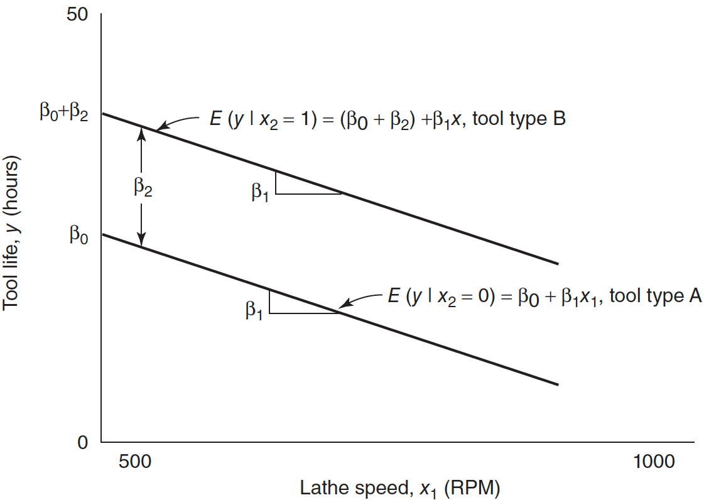
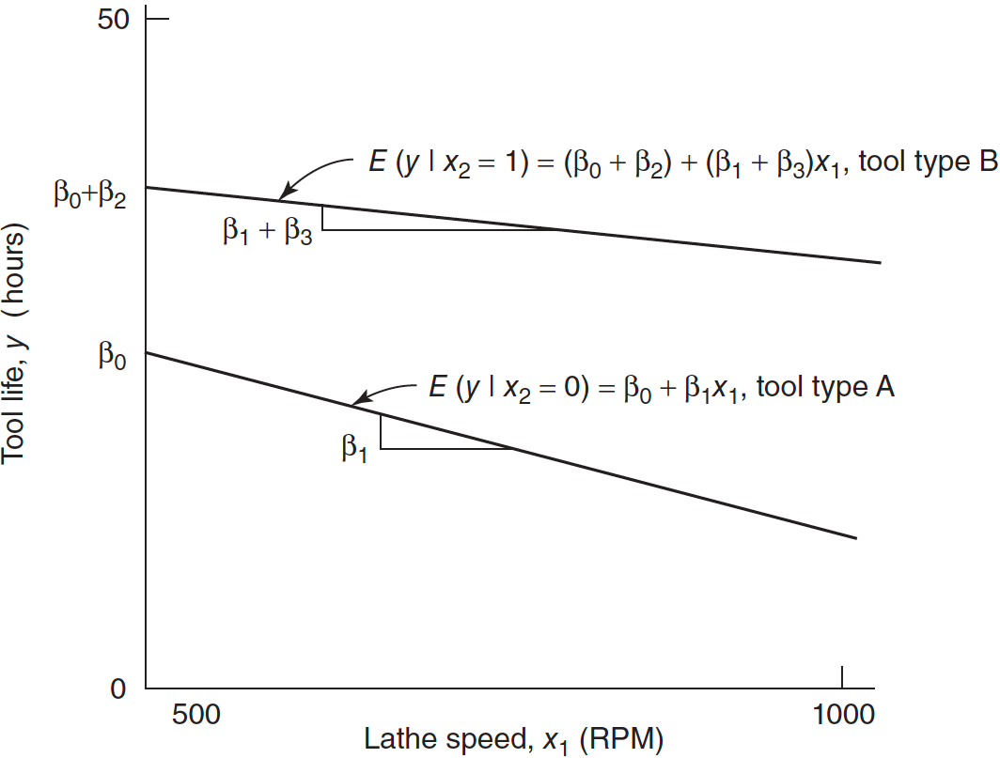

#  {visibility="hidden"}

\def\bx{\mathbf{x}}
\def\bg{\mathbf{g}}
\def\bw{\mathbf{w}}
\def\bbeta{\boldsymbol \beta}
\def\bX{\mathbf{X}}
\def\by{\mathbf{y}}
\def\bH{\mathbf{H}}
\def\bI{\mathbf{I}}
\def\bS{\mathbf{S}}
\def\bW{\mathbf{W}}
\def\T{\text{T}}
\def\cov{\mathrm{Cov}}
\def\cor{\mathrm{Corr}}
\def\var{\mathrm{Var}}
\def\E{\mathrm{E}}
\def\bmu{\boldsymbol \mu}
\DeclareMathOperator*{\argmin}{arg\,min}
\def\Trace{\text{Trace}}


```{r}
#| label: setup
#| include: false
#| eval: true
library(countdown)
library(emo)
library(knitr)
library(gt)
library(gtExtras)
library(ggplot2)
library(tidyverse)
library(tidymodels)

knitr::opts_chunk$set(
    fig.asp = 0.618,
    fig.align = "center",
    out.width = "100%",
    fig.retina = 10,
    fig.path = "./images/13-cat-var/",
    message = FALSE,
    global.par = TRUE
)
options(
  htmltools.dir.version = FALSE,
  dplyr.print_min = 6, 
  dplyr.print_max = 6,
  tibble.width = 80,
  width = 80,
  digits = 2
  )
hook_output <- knitr::knit_hooks$get("output")
knitr::knit_hooks$set(output = function(x, options) {
  lines <- options$output.lines
  if (is.null(lines)) {
    return(hook_output(x, options))  # pass to default hook
  }
  x <- unlist(strsplit(x, "\n"))
  more <- "..."
  if (length(lines)==1) {        # first n lines
    if (length(x) > lines) {
      # truncate the output, but add ....
      x <- c(head(x, lines), more)
    }
  } else {
    x <- c(more, x[lines], more)
  }
  # paste these lines together
  x <- paste(c(x, ""), collapse = "\n")
  hook_output(x, options)
})
```


```{r}
par(mar = c(3, 3.2, 0, 0), mgp = c(2, 0.5, 0), las = 1)
```


## Categorical Variables
- Examine the relationship between **numerical** response and **categorical** predictors.
<!-- - When a categorical variable has many levels/categories, they're encoded to **dummy variables**.     -->
  + <span style="color:blue"> **Gender** (Female  `r emo::ji('woman')`,  Male  `r emo::ji('man')`, Other  `r emo::ji('rainbow_flag')`) </span>: Gender income/wage gap
  + <span style="color:blue"> **Country** (USA `r emo::ji('us')`, Canada `r emo::ji('canada')`, UK `r emo::ji('uk')`, Germany `r emo::ji('de')`, Japan `r emo::ji('jp')`, Korea `r emo::ji('kr')`) </span>: Meat consumption level
  + <span style="color:blue"> **Political Party** (Republican `r emo::ji('red_circle')`, Democratic `r emo::ji('blue_circle')`, Other `r emo::ji('black_circle')`) </span>: Donation to healthcare

<!-- $$x = \begin{cases} 0  & \quad \text{male}\\ 1  & \quad \text{female}\\ 2 & \quad \text{other} \end{cases}$$ -->
<!-- $$x = \begin{cases} 0  & \quad \text{female}\\ 1 & \quad \text{other} \\ 2 & \quad \text{male} \end{cases}$$ -->

::: notes
- In regression, we may also want to examine the relationship between **numerical** response and **categorical (qualitative)** predictors.
- When a categorical variable has many levels/categories, they're encoded to **dummy variables** or **indicator variables**.    
  + <span style="color:blue"> **Gender** has two levels: female and male </span> 
  + <span style="color:blue"> **Blood Type**: A, B, AB and O </span>
  + <span style="color:blue"> **Education**: high school, bachelor, master, doctoral </span>
- In reality there are lots of categorical variables, especially in social science studies.
- Categorical variables are equally important as numerical variables.
- This deck covers two lectures. **Part I**: indicator variables, parallel lines vs. different slopes, factors in R, more than two levels (tool life, CIA by region). **Part II**: several categorical variables, comparing regression models (parallel / concurrent / coincident), and the regression approach to ANOVA.
- Pacing, Part I (75 min): motivation ~8 | indicator variables & parallel lines ~15 | factors in R, coding pitfalls ~10 | interaction & tests ~17 | more than 2 levels (AC example + CIA lab) ~20 | summary ~5.
- Pacing, Part II (75 min): two categorical variables (+ lab) ~20 | comparing regression models (+ CIA lab) ~25 | regression approach to ANOVA (+ lab) ~20 | indicators for a quantitative x & summary ~10.


<!-- $$x = \begin{cases} 0  & \quad \text{male}\\ 1  & \quad \text{female} \end{cases}$$ -->
<!-- $$x = \begin{cases} 0  & \quad \text{female}\\ 1  & \quad \text{male} \end{cases}$$ -->
:::


## Categorical Variable in Regression


<!-- **Without** categorical variable *Gender* -->


:::: {.columns}

::: {.column width="50%"}
<br>

```{r}
par(mar = c(3.2, 3.2, 0, 0), mgp = c(2, 0.5, 0), las = 1)
set.seed(4780)
x_f <- c(seq(60, 63, by = 0.6), seq(63, 69, by = 0.3), seq(69, 72, by = 0.6))
x_m <- c(seq(66, 69, by = 0.6), seq(69, 75, by = 0.3), seq(75, 78, by = 0.6))
y_f <- 10 + 1.8 * x_f + rnorm(length(x_f), sd = 12)
y_m <- -65 + 3.4 * x_m + rnorm(length(x_m), sd = 12)
y <- c(y_f, y_m)
x <- c(x_f, x_m)
plot(x, y, xlim = c(60, 79), ylim = c(95, 220), xlab = "Height (in)", 
     ylab = "Weight (lbs)", pch = 16, cex = 2, cex.lab = 1.5)
abline(lm(y~x), col = "red", lwd = 4)
```

::: notes
- May draw inappropriate height-weight relationship if gender factor is ignored.
- Because female tend to be shorter and weight less.
- Moreover, the weight increased may be at different rate in gender.
:::

:::


::: {.column width="50%"}

::: {.fragment}

**With** categorical variable *Gender*

```{r}
par(mar = c(3.2, 3.2, 0, 0), mgp = c(2, 0.5, 0), las = 1)
plot(x_f, y_f, xlim = c(60, 79), ylim = c(95, 220), xlab = "Height (in)", 
     ylab = "Weight (lbs)", pch = 16, col = 2, cex = 2, cex.lab = 1.5)
points(x_m, y_m, pch = 15, col = 4, cex = 2)
abline(lm(y_f~x_f), col = 2, lwd = 4)
abline(lm(y_m~x_m), col = 4, lwd = 4)
legend("bottomright", c("Female", "Male"), pch = c(16, 15), col = c(2, 4), bty = "n",
       cex = 1.5)
```
:::
:::
::::


::: {.fragment}

- Inappropriate height-weight relationship if gender factor is ignored.
- The two groups have different $\beta_0$ and $\beta_1$.

:::


::: notes
- A more appropriate regression model should include the gender variable when we explain the relationship between height and weight.
- The two groups in general will have different $\beta_0$ and $\beta_1$. And the difference is generally quite significant.
- This example tells us not only numerical variables, it is also important to include relevant categorical variables that greatly affect the response of interest.
:::

<!-- - For a categorical variable having the *nominal* level of measurements, we use **dummy** variables or **indicator** variables to assign a set of levels to the variable to account for the effect that the variable may have on the response. -->
<!--   + **Nominal** level of measurements: The indicator *level* itself has no meaningful ordering. It is just used to distinguish the variable's effect on the response. -->
<!--   + **Ordinal** level of measurements:  -->
<!-- [FIGURE] -->


## Example 8.1 [Tool Life Data](./data/data-ex-8-1.csv) (LRA)
Relate the effective life (hours) of a cutting tool $(y)$ used on a lathe to

- the lathe *speed* in revolutions per minute $(x_1)$ (Numerical)

- the *type* of cutting tool used $(x_2)$ (Categorical)

<!-- <br> -->

:::: {.columns}

::: midi
::: {.column width="25%"}

```{r}
#| class-output: my_class800
tool_data <- read.csv("./data/data-ex-8-1.csv", header = TRUE)
tool_data <- tool_data[, 2:4]
colnames(tool_data) <- c("hours", "speed", "type")
tool_data$speed[7] <- 680   # LRA Table 8.1 value (the csv has 580)
tool_data
```

:::

::: {.column width="75%"}

```{r}
#| out-width: 80%
par(mar = c(3, 3.2, 0, 0), mgp = c(2, 0.5, 0), las = 1)
plot(tool_data$speed[1:20], tool_data$hours[1:20], xlim = c(500, 1000), ylim = c(10, 45), 
     xlab = "Speed (RPM, x1)", ylab = "Tool Life (Hours, y)", pch = 16, col = 1, cex = 1.5,
     cex.lab = 1.5)
# points(tool_data$speed[11:20], tool_data$hours[11:20], pch = 15, col = 4, cex = 1.5)
# legend("topright", c("A", "B"), pch = c(16, 15), col = c(2, 4), bty = "n")
abline(lm(tool_data$hours~tool_data$speed))
```

:::

:::
::::


::: notes
- Scatterplot of life against speed without considering the type of cutting tool.
- We may think the distance between data points and the regression fit is a pure random noise, and their variation is that big.
- But in fact those variations may be due to some other variables that are not included in the model, like the type of the tool.
:::


## Indicator Variable

:::: {.columns}

::: {.column width="50%"}
- Tool type can be represented as:
$$x_2 = \begin{cases} 0  & \quad \text{Tool type A}\\ 1  & \quad \text{Tool type B} \end{cases}$$ where $x_2$ is a **dummy variable**.
- If a *first-order* model is appropriate:
$$y = \beta_0+\beta_1x_1+\beta_2x_2 + \epsilon, \quad \epsilon \sim N(0, \sigma^2)$$
- Assume that the *variance is the same for both levels* (type A and B).
:::


::: {.column width="50%"}
```{r}
par(mar = c(3, 3.2, 0, 0), mgp = c(2, 0.5, 0), las = 1)
plot(tool_data$speed[1:10], tool_data$hours[1:10], xlim = c(500, 1000), ylim = c(10, 45), 
     xlab = "Speed (RPM, x1)", ylab = "Tool Life (Hours, y)", pch = 16, col = 2, cex = 2,
     cex.lab = 1.5)
points(tool_data$speed[11:20], tool_data$hours[11:20], pch = 15, col = 4, cex = 2)
legend("topright", c("A", "B"), pch = c(16, 15), col = c(2, 4), bty = "n", cex = 1.5)
```
:::
::::

::: notes
- When we label data points by their tool type, we can clearly see that given the same level of the speed, type B tends to have longer life than type A.
- So if we simply ignore the tool type, and predict the tool life based solely on the speed, we are gonna have pretty large prediction error.
- Our fitted line is sort of between the two types, so we underestimates the life of tool B, and overestimate the life of tool A.
- To model and describe the effect of the categorical variable, we use a so-called dummy variable, or indicator variable.
- For example here, we consider two different types of cutting tool, A and B. 
- $x_2 = \begin{cases} 0  & \quad \text{Tool type A}\\ 1  & \quad \text{Tool type B} \end{cases}$
- If the categorical variable has two categories, we need one dummy variable. 
- In general, if a categorical variable has $k$ categories, we are gonna need $k-1$ dummy variables put in the regression model.
- *first-order* means no interaction terms as well as higher polynomial orders.
:::

## Interpretation of Coefficients
- For Tool type **A** $(x_2 = 0)$ the model becomes:
$$\begin{align} y &= \beta_0+\beta_1x_1+\beta_2(0) + \epsilon \\ &= \beta_0+\beta_1x_1+ \epsilon \end{align}$$
- For Tool type **B** $(x_2 = 1)$ the model becomes:
$$\begin{align} y &= \beta_0+\beta_1x_1+\beta_2(1) + \epsilon \\ &= (\beta_0 + \beta_2)+\beta_1x_1+ \epsilon \end{align}$$
- Changing from type A to B induces a **change in the intercept**, but **the slope is unchanged** and **identical**.
- Type A is the baseline level.

::: notes
- Changing from type A to B induces a **change in the intercept (slope is unchanged and identical)**.
- The model includes the response shifting effect.
- Assume that the *variance is the same for both levels* (type A and B) of the categorical variable. 
- Type A is the baseline level. The baseline level is the level corresponding to the dummy variable being zero.
- The original intercept term is for the baseline level.
:::


## Parallel Regression Lines
- Two **parallel** regression lines with a common slope $\beta_1$ and different intercepts.
- $\beta_2$ measures the *difference in mean tool life* resulting from changing from tool type A to B.


:::: {.columns}

::: {.column width="50%"}

$y = \beta_0+\beta_1x_1+\beta_2x_2 + \epsilon$


```{r}

```
:::


::: {.column width="50%"}

::: {.fragment}

$\hat{y} = b_0 + b_1 x_1 + b_2 x_2$

```{r}
#| out-width: 100%
#| fig-asp: 0.7
par(mar = c(3, 3.2, 0, 0), mgp = c(2, 0.5, 0), las = 1)
plot(tool_data$speed[1:10], tool_data$hours[1:10], xlim = c(500, 1000), ylim = c(10, 45), 
     xlab = "Speed (RPM, x1)", ylab = "Tool Life (Hours, y)", pch = 16, col = 2, cex = 2, cex.lab = 1.5)
points(tool_data$speed[11:20], tool_data$hours[11:20], pch = 15, col = 4, cex = 2, cex.lab = 1.5)
legend("topright", c("A", "B"), pch = c(16, 15), col = c(2, 4), bty = "n", cex = 1.5)
b_par <- coef(lm(hours ~ speed + type, data = tool_data))
abline(a = b_par[1], b = b_par[2], col = 2, lwd = 2)
abline(a = b_par[1] + b_par[3], b = b_par[2], col = 4, lwd = 2)
```
:::
:::
::::


::: notes
- Two **parallel** regression lines with a common slope $\beta_1$ and different intercepts.
- $\beta_2$ expresses the difference in heights between the two lines, measuring the difference in mean tool life resulting from changing from tool type A to type B.
:::

## [R Lab]{.pink} Model Fitting

- The categorical variable should be of type `character` or `factor`.

```{r}
#| echo: true
str(tool_data)
```

```{r}
#| echo: true
full_model <- lm(hours ~ speed + type, data = tool_data)
summary(full_model)$coef
```

- $\hat{y} = 37 -0.027x_1 +15x_2$
- All else held constant, type B tools are expected, on average, to have 15 hours *longer* life than the baseline.

::: notes
- The dummy variable will be created based on the factor level that is created when the categorical variable is transformed to be of type factor.
- By default, the factor level is created in alphabetical order.
- Can specify level using argument levels in factor() function.
- If factor has been created, can use relevel() to relevel the factor. 

```{r}
fac <- factor(tool_data$type)
contrasts(fac)
re_fac <- relevel(fac, ref = "B")
re_fac_fit <- lm(hours ~ speed + re_fac, data = tool_data)
```
:::


## [R Lab]{.pink} How R Codes a Factor

```{r}
#| echo: true
#| code-line-numbers: false
tool_data$type <- factor(tool_data$type)
contrasts(tool_data$type)                       # A is the baseline (alphabetical)
head(model.matrix(hours ~ speed + type, data = tool_data), 3)
coef(lm(hours ~ speed + relevel(type, ref = "B"), data = tool_data))  # B as baseline
```

- Changing the baseline changes the **sign** of the dummy coefficient, not the fitted lines.


## Two Pitfalls with Categorical Predictors

- **Do not use allocated codes** such as A = 1, B = 2, C = 3 as a numerical regressor.
  + It forces the levels to be **ordered** and **equally spaced** in their effect on $y$: the change from A to B must equal the change from B to C.
  + Indicator variables let each level have its own effect.

. . .

- **Dummy variable trap**: with an intercept, use $m - 1$ indicators for $m$ levels.
  + With all $m$ indicators, $D_1 + D_2 + \cdots + D_m = 1$ = the intercept column: the columns of $\bf X$ are linearly dependent and $\bf X'X$ is singular.
  + R drops one level automatically (the baseline).

::: notes
- LRA Sec 8.2. If the categories are truly quantitative and equally spaced (e.g., 1, 2, 3 years), a numerical regressor may be fine; that is an assumption to check, not a default.
:::


## Model Checking

:::: {.columns}

::: {.column width="50%"}

Same variance of the errors for both A and B?

```{r}
#| out-width: 100%
#| fig-asp: 0.7
par(mar = c(3, 3.2, 0, 0), mgp = c(2, 0.5, 0), las = 1)
r_stud <- MASS::studres(full_model)
# par(mar = c(3, 3, 1, 0), mgp = c(2, 0.5, 0), las = 1)
plot(full_model$fitted.values, r_stud, col = c(rep(2, 10), rep(4, 10)), cex = 2, cex.lab = 1.5,
     pch = c(rep(16, 10), rep(15, 10)), xlab = "fitted y", ylab = "R-student residual")
legend("topleft", c("A", "B"), pch = c(16, 15), col = c(2, 4), bty = "n", cex = 1.5)
```
:::


::: {.column width="50%"}
Approximately normal

```{r}
#| out-width: 100%
#| fig-asp: 0.7
par(mar = c(3, 3.2, 0, 0), mgp = c(2, 0.5, 0), las = 1)
car::qqPlot(r_stud, id = FALSE, ylab = "R-student residual sample quantiles",
            pch = 16, cex = 2)
```
:::
::::


## Single Model vs. Separate Models
- Two separate models, one for each type, could have been fit to the data.
$$y^A = \beta_0^A+\beta_1x_1^A+ \epsilon^A, \quad \epsilon^A \sim N(0, \sigma^2)$$
$$y^B = \beta_0^B+\beta_1x_1^B+ \epsilon^B, \quad \epsilon^B \sim N(0, \sigma^2)$$

::: question
If performing well, the single-model approach with dummy variables is preferred.
:::

. . .

- Only one equation to work with, $y = \beta_0+\beta_1x_1+\beta_2x_2 + \epsilon$, a simpler practical result.

. . .

- Both lines are assumed to have the same slope $\beta_1$ and error variance $\sigma^2$.
  + Combine the data to produce a single estimate of the common parameters.
  + Use more data to estimate the parameters, and the estimation quality would be better.
  
  
::: notes
- Since two regression lines are expected to model the relationship between tool life and lathe speed, we could have fit two separate models with no dummy variables to the data.
  
:::


## Difference in Slope

- If we expect *the slopes to differ*, include an **interaction** term between the variables:
$$y = \beta_0+\beta_1x_1+\beta_2x_2 + \color{blue}{\beta_3x_1x_2} + \epsilon$$

. . .

- Tool type A $(x_2 = 0)$: $$\begin{align} y &= \beta_0+\beta_1x_1+\beta_2(0) + \beta_3x_1(0) + \epsilon \\ &= \beta_0+\beta_1x_1+ \epsilon \end{align}$$
- Tool type B $(x_2 = 1)$: $$\begin{align} y &= \beta_0+\beta_1x_1+\beta_2(1) + \beta_3x_1(1) + \epsilon \\ &= (\beta_0+ \beta_2) + (\beta_1+\beta_3)x_1+ \epsilon \end{align}$$
  + $\beta_2$ is the change in the *intercept* caused by changing from type A to type B.
  + $\beta_3$ is the change in the *slope* caused by changing from type A to type B.

::: notes
- If we expect *the slopes to differ*, we can model this phenomenon by including an **interaction** term between the variables.
- Back to the tool life data, and say we believe there may be different slopes for the two tools. The model we can fit to account for the change in slope is:
$$y = \beta_0+\beta_1x_1+\beta_2x_2 + \beta_3x_1x_2 + \epsilon$$
- Tool type A : $$\begin{align} y &= \beta_0+\beta_1x_1+\beta_2(0) + \beta_3x_1(0) + \epsilon \\ &= \beta_0+\beta_1x_1+ \epsilon \end{align}$$
- Tool type B : $$\begin{align} y &= \beta_0+\beta_1x_1+\beta_2(1) + \beta_3x_1(1) + \epsilon \\ &= (\beta_0+ \beta_2) + (\beta_1+\beta_3)x_1+ \epsilon \end{align}$$
<!-- .question[ -->
<!-- How do we create a model with different slopes? -->
<!-- ] -->

<!-- -- -->
:::


## Response Function for the Tool Life Example
- $y = \beta_0+\beta_1x_1+\beta_2x_2 + \beta_3x_1x_2 + \epsilon$ defines two regression lines with different slopes and intercepts.
<!-- - $\beta_2$ is the change in the *intercept* caused by changing from type A to type B. -->
<!-- - $\beta_3$ is the change in the *slope* caused by changing from type A to type B. -->
<!-- - Type A is the baseline level. -->

:::: {.columns}

::: {.column width="50%"}

$y = \beta_0+\beta_1x_1+\beta_2x_2 + \beta_3x_1x_2+\epsilon$


```{r}
#| out-width: 100%

```
:::


::: {.column width="50%"}


::: {.fragment}

$\hat{y} = b_0 + b_1 x_1 + b_2x_2 + b_3 x_1 x_2$


```{r}
#| out-width: 100%
#| fig-asp: 0.7

par(mar = c(3, 3.2, 0, 0), mgp = c(2, 0.5, 0), las = 1)
plot(tool_data$speed[1:10], tool_data$hours[1:10], xlim = c(500, 1000), ylim = c(10, 45), 
     xlab = "Speed (RPM, x1)", ylab = "Tool Life (Hours, y)", pch = 16, col = 2, cex = 2,cex.lab = 1.5)
points(tool_data$speed[11:20], tool_data$hours[11:20], pch = 15, col = 4, cex = 2, cex.lab = 1.5)
legend("topright", c("A", "B"), pch = c(16, 15), col = c(2, 4), bty = "n", cex = 1.5)
b_int <- coef(lm(hours ~ speed * type, data = tool_data))
abline(a = b_int[1], b = b_int[2], col = 2, lwd = 2)
abline(a = b_int[1] + b_int[3], b = b_int[2] + b_int[4], col = 4, lwd = 2)
```
:::
:::
::::


::: notes
- Type A is the baseline level
:::

## Two Models
- The model $y = \beta_0+\beta_1x_1+\beta_2x_2 + \beta_3x_1x_2 + \epsilon$ is equivalent to fitting two separate regressions:
  + $y = \beta_0+\beta_1x_1+ \epsilon$
  + $y = \alpha_0 + \alpha_1x_1+ \epsilon$, $\quad \alpha_0 = \beta_0 + \beta_2$, $\quad \alpha_1 = \beta_1 + \beta_3$.


<!-- $$y^A = \beta_0^A+\beta_1^Ax_1^A+ \epsilon^A$$ -->
<!-- $$y^B = \beta_0^B+\beta_1^Bx_1^B+ \epsilon^B$$ -->


::: question
How do we test if the 2 regressions are identical?
:::

. . .

- Can use the extra sum of squares method by comparing the full and reduced models.
- $H_0: \beta_2 = \beta_3 = 0 \quad H_1: \beta_2 \ne 0 \text{ and(or) } \beta_3 \ne 0$

::: notes
- test if the categorical variable affect intercept and or slope. 
- In other words, we can test if the tool type affects the effect of tool speed on the tool life.
:::

## [R Lab]{.pink} Regression Model with Interaction 
```{r}
#| echo: true
(full_model <- lm(hours ~ speed + type + speed:type, data = tool_data))
```

. . .

```{r}
#| echo: true
(full_model <- lm(hours ~ speed*type, data = tool_data))
```

<!-- - Fit the model $$y = \beta_0+\beta_1x_1+\beta_2x_2 + \beta_3x_1x_2 + \epsilon$$ -->
- The fitted model is $$\hat{y} = 32.8-0.02x_1+23.97x_2 -0.01x_1x_2$$

## [R Lab]{.pink} Regression Lines
:::: {.columns}

::: {.column width="50%"}
$y = \beta_0+\beta_1x_1 + \epsilon$

```{r}
#| out-width: 100%
#| fig-asp: 0.7
par(mar = c(3, 3.2, 0, 0), mgp = c(2, 0.5, 0), las = 1)
plot(tool_data$speed[1:10], tool_data$hours[1:10], xlim = c(500, 1000), ylim = c(10, 45), 
     xlab = "Speed (RPM, x1)", ylab = "Tool Life (Hours, y)", pch = 16, col = 2, cex = 2, cex.lab = 1.5)
points(tool_data$speed[11:20], tool_data$hours[11:20], pch = 15, col = 4, cex = 2, cex.lab = 1.5)
legend("topright", c("A", "B"), pch = c(16, 15), col = c(2, 4), bty = "n", cex = 1.5)
abline(a = b_par[1], b = b_par[2], col = 2, lwd = 2)
abline(a = b_par[1] + b_par[3], b = b_par[2], col = 4, lwd = 2)
abline(lm(hours ~ speed, data = tool_data), lwd = 2)
```
:::


::: {.column width="50%"}
$y = \beta_0+\beta_1x_1+\beta_2x_2 + \beta_3x_1x_2+\epsilon$


```{r}
#| out-width: 100%
#| fig-asp: 0.7

par(mar = c(3, 3.2, 0, 0), mgp = c(2, 0.5, 0), las = 1)
plot(tool_data$speed[1:10], tool_data$hours[1:10], xlim = c(500, 1000), ylim = c(10, 45), 
     xlab = "Speed (RPM, x1)", ylab = "Tool Life (Hours, y)", pch = 16, col = 2, cex = 2,cex.lab = 1.5)
points(tool_data$speed[11:20], tool_data$hours[11:20], pch = 15, col = 4, cex = 2, cex.lab = 1.5)
legend("topright", c("A", "B"), pch = c(16, 15), col = c(2, 4), bty = "n", cex = 1.5)
abline(a = b_int[1], b = b_int[2], col = 2, lwd = 2)
abline(a = b_int[1] + b_int[3], b = b_int[2] + b_int[4], col = 4, lwd = 2)
```
:::
::::

## [R Lab]{.pink} Test Effect of Tool Type
- $H_0: \beta_2 = \beta_3 = 0 \quad H_1: \beta_2 \ne 0 \text{ and(or) } \beta_3 \ne 0$

```{r}
#| echo: true
reduced_model <- lm(hours ~ speed, data = tool_data)
anova(reduced_model, full_model)
```

- $F_{test} = \frac{SS_R(\beta_2, \beta_3 |\beta_1, \beta_0)/2}{MS_{Res}} = \frac{1141/2}{141/16} = 64.75 > F_{0.05, 2, 16} = 3.63$

- The two regression lines are not identical.


## [R Lab]{.pink} Do the Slopes Differ?
- $H_0: \beta_3 = 0$ (parallel lines) $\quad H_1: \beta_3 \ne 0$

```{r}
#| echo: true
parallel_model <- lm(hours ~ speed + type, data = tool_data)
anova(parallel_model, full_model)
```

- $p = 0.20$: no evidence that the slopes differ. The **parallel-lines** model (common slope, different intercepts) is adequate.
- Same as the $t$ test for `speed:typeB` in the interaction model ($t^2 = F$).

::: notes
- Summary of the tool life analysis: tool type matters (the lines are not identical), but only through the intercept. Type B lasts about 15 hours longer at any speed.
:::


## More than 2 Categories
- For a categorical predictor with $m$ levels, we need $m-1$ dummies.
- Three tool types, A, B, and C. Then two indicators $x_2$ and $x_3$ will be needed:

|   Tool Type   | $x_2$ | $x_3$   |
|:-----------:|:-------:|:-------:|
|  A | 0  | 0 |  
|  B   | 1 | 0  |
|  C   | 0 | 1  |

- The regression model (common slope) is
$$y = \beta_0+\beta_1x_1+\beta_2x_2 + \beta_3x_3 + \epsilon$$
- Type A is the baseline level.

::: notes
- Type A is the baseline level. The base line level is the category corresponding value zero for all dummies.
- $\beta_0$ is the intercept when A is used.
- $\beta_2$ is the change in the intercept when the tool changes from A to B.
- $\beta_3$ is the change in the intercept when the tool changes from A to C.
- What is the change in the intercept when the tool changes from B to C.
:::


## Example 8.3: More Than 2 Levels (LRA)

- An electric utility is investigating the effect of the *size* of a single family house $(x_1)$ and the *type* of air conditioning used on the total electricity consumption $(y)$.

|    Type of Air Conditioning  | $x_2$ | $x_3$   | $x_4$
|:-----------:|:-------:|:-------:|:-------:|
| No air conditioning | 0  | 0 |  0 |
| Window units   | 1 | 0  | 0 |
| Heat pump   | 0 | 1  | 0 |
| Central air conditioning  | 0 | 0  | 1 |

::: question
Which type is the baseline level?
:::

::: notes
- An electric utility is investigating the effect of the *size* of a single family house $(x_1)$ and the *type* of air conditioning used in the house on the total electricity consumption during summer months $(y)$.
- Since there are 4 categories, 3 dummy variables are used to differentiate their effect on $y$.
- No air conditioning is the baseline level
:::


## Example 8.3: Dummy Variables
The regression model is $y = \beta_0+\beta_1x_1+\beta_2x_2 + \beta_3x_3 + \beta_4x_4 + \epsilon$

::: notes
- 2 predictors, but 4 x's, because x2, x3 and x4 are for the variable Type of Air
:::


. . .

:::: {.columns}

::: {.column width="50%"}

<br>

*"No air conditioning"* is the baseline level.

<br>

|    Type of Air Conditioning  | $x_2$ | $x_3$   | $x_4$
|:-----------:|:-------:|:-------:|:-------:|
| No air conditioning | 0  | 0 |  0 |
| Window units   | 1 | 0  | 0 |
| Heat pump   | 0 | 1  | 0 |
| Central air conditioning  | 0 | 0  | 1 |

:::


::: {.column width="50%"}

::: midi
If the house has

- no air conditioning,

$$y = \beta_0+\beta_1x_1 + \epsilon$$

- window units,

$$y = (\beta_0 + \beta_2)+\beta_1x_1 + \epsilon$$

- a heat pump,

$$y = (\beta_0 + \beta_3) +\beta_1x_1 + \epsilon$$

- central air conditioning,

$$y = (\beta_0 + \beta_4) +\beta_1x_1 + \epsilon$$
:::
:::
::::


::: notes
- The type *"No air conditioning"* is the baseline level. 
- The model assumes that the relationship between electricity consumption and the size of the house is linear and the slope does not depend on the type of air conditioning system employed.
- The parameters β 2 , β 3 , and β 4 modify the height (or intercept) of the regression model for the different types of air conditioning systems. 
- That is, β 2 , β 3 , and β 4 measure the effect of window units, a heat pump, and a central air conditioning system, respectively, compared to no air conditioning. 
- Furthermore, other effects can be determined by directly comparing the appropriate regression coefficients. For example, β 3 − β 4 reflects the relative efficiency of a heat pump compared to central air conditioning.
- Negative means saving more energy.
:::


## Example 8.3: Interaction
::: question
Do you think the model $y = \beta_0+\beta_1x_1+\beta_2x_2 + \beta_3x_3 + \beta_4x_4 + \epsilon$ is reasonable?
:::

. . .

- It seems unrealistic to assume that the slope $\beta_1$ relating mean electricity consumption to the house size does NOT depend on air-conditioning type.
- The consumption increases with the house size.
- The **rate of increase should be different** because a more efficient central air conditioning system should have a consumption rate lower than window units.
- Add **interaction** between the house size and the type of air conditioning:
$$y = \beta_0+\beta_1x_1+\beta_2x_2 + \beta_3x_3 + \beta_4x_4 + \beta_5x_1x_2 + \beta_6 x_1x_3 + \beta_7 x_1x_4 + \epsilon$$


::: notes
- It would seem unrealistic to assume that the slope of the regression function relating mean electricity consumption to the size of the house does not depend on the type of air conditioning system.
- We would expect the mean electricity consumption to increase with the size of the house, but the **rate of increase should be different** for a central air conditioning system than for window units because central air conditioning should be more efficient than window units for larger houses.
- There should be an **interaction** between the size of the house and the type of air conditioning system:
$$y = \beta_0+\beta_1x_1+\beta_2x_2 + \beta_3x_3 + \beta_4x_4 + \beta_5x_1x_2 + \beta_6 x_1x_3 + \beta_7 x_1x_4 + \epsilon$$
- The assumption that the variance of energy consumption does not depend on the type of air conditioning system used may be inappropriate.
:::


## Example 8.3: Unique Slope and Intercept
$y = \beta_0+\beta_1x_1+\beta_2x_2 + \beta_3x_3 + \beta_4x_4 + \beta_5x_1x_2 + \beta_6 x_1x_3 + \beta_7 x_1x_4 + \epsilon$

. . .

:::: {.columns}

::: {.column width="50%"}

<br>

*"No air conditioning"* is the baseline level.

<br>

|    Type of Air Conditioning  | $x_2$ | $x_3$   | $x_4$
|:-----------:|:-------:|:-------:|:-------:|
| No air conditioning | 0  | 0 |  0 |
| Window units   | 1 | 0  | 0 |
| Heat pump   | 0 | 1  | 0 |
| Central air conditioning  | 0 | 0  | 1 |

:::


::: {.column width="50%"}

::: midi

- No air conditioning:
$$y = \beta_0+\beta_1x_1 + \epsilon$$

- Window units:
$$y = (\beta_0 + \beta_2)+(\beta_1+\beta_5)x_1 + \epsilon$$

- Heat pump:
$$y = (\beta_0 + \beta_3) +(\beta_1+\beta_6)x_1 + \epsilon$$

- Central air conditioning:
$$y  = (\beta_0 + \beta_4) +(\beta_1+\beta_7)x_1 + \epsilon$$

:::
:::

::::


- $\beta_5$ is the effect of window units on the slope, comparing to the slope when no air conditioning is used.


## [R Lab]{.pink} A Factor with 5 Levels: CIA Data by Region

```{r}
#| echo: true
#| code-line-numbers: false
CIA <- read.table("./data/CIA.txt", header = TRUE)
CIA$region <- factor(CIA$region)          # Africa is the baseline
table(CIA$region)
region_par <- lm(log(infant) ~ log(gdp) + region, data = CIA)
round(summary(region_par)$coef, 3)
```

::: notes
- 5 levels need 4 dummies: `regionAmerica`, `regionAsia`, `regionEurope`, `regionOceania`.
- Europe: $e^{-0.867} = 0.42$, so at the same GDP, European countries have about 58% lower infant mortality than African countries.
- `log(gdp)` slope: a 1% increase in GDP is associated with about a 0.64% decrease in infant mortality (log-log).
:::


## [R Lab]{.pink} CIA Data: Parallel Lines by Region

```{r}
#| out-width: 70%
#| fig-asp: 0.55
par(mar = c(3.5, 3.5, 0.5, 0.5), mgp = c(2, 0.6, 0), las = 1)
reg_col <- c(Africa = 2, America = 4, Asia = 3, Europe = 6, Oceania = 1)
plot(log(CIA$gdp), log(CIA$infant), pch = 16, col = reg_col[as.character(CIA$region)],
     xlab = "log(GDP per capita, $1000s)", ylab = "log(infant mortality)")
b_reg <- coef(region_par)
for (k in seq_along(levels(CIA$region))) {
  shift <- if (k == 1) 0 else b_reg[2 + k - 1]
  abline(a = b_reg[1] + shift, b = b_reg[2], col = reg_col[levels(CIA$region)[k]], lwd = 2)
}
legend("topright", levels(CIA$region), col = reg_col[levels(CIA$region)], pch = 16,
       lwd = 2, bty = "n", cex = 1.1)
```

- Common slope, region-specific intercepts. Does each region need its **own slope**? (Part II)


## Summary: Part I

- A categorical predictor with $m$ levels enters the model through $m - 1$ **indicator variables**; the omitted level is the **baseline**.
- Dummy coefficients are **differences from the baseline** (shift in intercept).
- **Interaction** $x \times D$ lets the slope differ by group; test it with the extra-sum-of-squares $F$ test.
- In R: `factor()`, `relevel()`, `contrasts()`, `model.matrix()`; `lm(y ~ x * group)`.
- Do not use allocated codes (1, 2, 3, ...) for unordered categories.


# Part II: Several Categorical Variables and Comparing Models


## More Than One Categorical Variable: Model
- Frequently several categorical variables must be incorporated into the model.
- Suppose in the cutting tool life example a second categorical variable, the *type of cutting oil used*, must be considered.
- Assuming that the variable has two levels:
$$x_3 = \begin{cases} 0  & \quad \text{low-viscosity oil used}\\ 1  & \quad \text{medium-viscosity oil used} \end{cases}$$
- A regression model relating tool life $(y)$ to cutting speed $(x_1)$, tool type $(x_2)$, and type of cutting oil $(x_3)$ is
$$y = \beta_0+\beta_1x_1+\beta_2x_2 + \beta_3x_3 + \epsilon$$

. . .

::: alert
`r emo::ji('exclamation')` The model has the *same* expression as the model with *only one categorical variable having 3 categories*. But the meaning is totally different!
:::


::: notes

- Clearly the slope β 1 of the regression model relating tool life to cutting speed does not depend on either the type of tool or the type of cutting oil. The intercept of the regression line depends on these factors in an additive fashion.

:::


## More Than One Categorical Variable: Interaction

- Add interactions between cutting speed $x_1$ and the two categorical variables:
$$y = \beta_0+\beta_1x_1+\beta_2x_2 + \beta_3x_3 + \color{blue}{\beta_4x_1x_2} + \color{blue}{\beta_5x_1x_3} + \epsilon$$

| Tool Type   | Cutting Oil | Regression Model|
|:-----------:|:-----------:|:-------|
| A $\small (x_2 = 0)$ | Low-viscosity $\small (x_3 = 0)$| $\small y = \beta_0+\beta_1x_1 + \epsilon$ |
| B $\small (x_2 = 1)$ | Low-viscosity $\small (x_3 = 0)$| $\small y = (\beta_0+ \beta_2) + (\beta_1+\beta_4)x_1 + \epsilon$ | 
| A $\small (x_2 = 0)$  | Medium-viscosity $\small (x_3 = 1)$| $\small y = (\beta_0+ \beta_3) + (\beta_1+\beta_5)x_1 + \epsilon$| 
| B $\small (x_2 = 1)$ | Medium-viscosity $\small (x_3 = 1)$| $\small y = (\beta_0+ \beta_2 + \beta_3) + (\beta_1+\beta_4 + \beta_5)x_1 + \epsilon$ | 


- Each combination results in a separate regression line with different slopes and intercepts.
- Changing from low to medium-viscosity cutting oil changes the intercept by $\beta_3$ and the slope by $\beta_5$ **regardless of the type of tool used.**
- No interaction between the 2 categorical variables.

::: notes
- Each combination of tool type and cutting oil results in a separate regression line, with different slopes and intercepts.
- Changing from low to medium-viscosity cutting oil changes the intercept by $\beta_3$ and the slope by $\beta_5$ **regardless of the type of tool used.**
<!-- - Various types of interaction effects may be added to the model. -->
The model is still additive with respect to the levels of the indicator variables.
:::

## Interaction between Categorical Variables
- Add a *cross-product* term involving the two dummy variables $x_2$ and $x_3$ to the model:
$$y = \beta_0+\beta_1x_1+\beta_2x_2 + \beta_3x_3 + \beta_4x_1x_2 + \beta_5x_1x_3 + \color{blue}{\beta_6x_2x_3} + \epsilon$$

| Tool Type   | Cutting Oil | Regression Model|
|:-----------:|:-------------:|:-------|
| A $\small (x_2 = 0)$ | Low-viscosity $\small (x_3 = 0)$| $\small y = \beta_0+\beta_1x_1 + \epsilon$ |
| B $\small (x_2 = 1)$ | Low-viscosity $\small (x_3 = 0)$| $\small y = (\beta_0+ \beta_2) + (\beta_1+\beta_4)x_1 + \epsilon$ | 
| A $\small (x_2 = 0)$  | Medium-viscosity $\small (x_3 = 1)$| $\small y = (\beta_0+ \beta_3) + (\beta_1+\beta_5)x_1 + \epsilon$| 
| B $\small (x_2 = 1)$ | Medium-viscosity $\small (x_3 = 1)$| $\small y = (\beta_0+ \beta_2 + \beta_3 + \beta_6) + (\beta_1+\beta_4 + \beta_5)x_1 + \epsilon$ | 

- Changing from low to medium-viscosity cutting oil changes the intercept by $\beta_3$ if tool type A is used.
- The same change in cutting oil changes the intercept by $\beta_3 + \beta_6$ if tool type B is used.

::: notes
- The addition of the cross-product term $\beta_6x_2x_3$ results in the effect of one indicator variable on the intercept depending on the level of the other indicator variable. 
:::


## [R Lab]{.pink} Two Categorical Variables: `mtcars`

- `mpg` vs. weight `wt`, transmission `am` (automatic/manual) and engine shape `vs` (V-shaped/straight):

```{r}
#| echo: true
#| code-line-numbers: false
cars <- transform(mtcars, am = factor(am, labels = c("automatic", "manual")),
                  vs = factor(vs, labels = c("V-shaped", "straight")))
additive <- lm(mpg ~ wt + am + vs, data = cars)
inter    <- lm(mpg ~ wt + am * vs, data = cars)   # adds am:vs
round(summary(additive)$coef, 3)
anova(additive, inter)
```

- `am:vs` is not significant ($p = 0.11$): the effect of the engine shape on mean mpg does not depend on the transmission.
- Holding weight and transmission fixed, straight engines get about 3.6 more mpg.

::: notes
- With am:vs, the four (am, vs) combinations each get their own intercept, as in the table on the previous slide.
- Only 32 cars: tests have limited power.
:::


## Comparing Regression Models
- Consider simple linear regression where the $n$ observations can be formed into $M$ groups, with the $m$-th group having $n_m$ observations. 
- The most general model consists of $M$ separate equations:
$$y = \beta_{0m} + \beta_{1m}x + \epsilon, \quad m = 1, 2, \dots, M$$
- We are interested in comparing this general model to a more restrictive one.

```{r}
#| fig-asp: 0.26
library(scales)
set.seed(4780)
par(mar = c(2, 2, 1, 0), mgp = c(2, 0.5, 0), las = 1)
par(mfrow = c(1, 3))
x <- seq(0, 10, by = 0.1)
n <- length(x)
y_0 <- x + rnorm(n)
y_4 <- 4 + x + rnorm(n)
y_8 <- 8 + x + rnorm(n)
plot(x, y_0, xlab = "", ylab = "", main = "Parallel Lines", pch = 0, 
     ylim = c(-5, 25), cex = 0.5, col = alpha(1, 0.5), cex.main = 1.5)
points(x, y_4, col = alpha(2, 0.5), pch = 1,  cex = 0.5)
points(x, y_8, col = alpha(4, 0.5), pch = 2,  cex = 0.5)
abline(a = 0, b = c(1), col = c(1), lwd = 3)
abline(a = 4, b = c(1), col = c(2), lwd = 3)
abline(a = 8, b = c(1), col = c(4), lwd = 3)
# =====
y_s2 <- 2*x + rnorm(n)
y_s3 <- 3*x + rnorm(n)
plot(x, y_0, xlab = "", ylab = "", main = "Concurrent Lines", pch = 0, 
     ylim = c(-5, 25), cex = 0.5, col = alpha(1, 0.5), cex.main = 1.5)
points(x, y_s2, col = alpha(2, 0.5), pch = 1,  cex = 0.5)
points(x, y_s3, col = alpha(4, 0.5), pch = 2,  cex = 0.5)
abline(a = 0, b = c(1), col = c(1), lwd = 3)
abline(a = 0, b = c(2), col = c(2), lwd = 3)
abline(a = 0, b = c(3), col = c(4), lwd = 3)
# =====
y_4_1 <- 4 + x + rnorm(n)
y_4_2 <- 4 + x + rnorm(n)
plot(x, y_4, xlab = "", ylab = "", main = "Coincident Lines", pch = 0, 
     ylim = c(-5, 25), cex = 0.5, col = alpha(1, 0.5), cex.main = 1.5)
points(x, y_4_1, col = alpha(2, 0.5), pch = 1,  cex = 0.5)
points(x, y_4_2, col = alpha(4, 0.5), pch = 2,  cex = 0.5)
abline(a = 4, b = c(1), col = alpha(1, 0.5), lwd = 3)
abline(a = 4, b = c(1), col = alpha(2, 0.5), lwd = 3)
abline(a = 4, b = c(1), col = alpha(4, 0.5), lwd = 3)
```


## Parallel Lines (Example 8.1 where $M = 2$)
All $M$ slopes are identical
$H_0: \beta_{11} = \beta_{12} = \cdots = \beta_{1M} = \beta_1$

- **Full Model** $(F)$: $y = \beta_{0m} + \beta_{1m}x + \epsilon, \quad m = 1, 2, \dots, M$.

- **Reduced Model** $(R)$: $y = \beta_0 + \beta_1x + \color{blue}{\beta_2D_1 + \beta_3D_2 + \cdots + \beta_{M-1}D_{M-1}}+\epsilon$, where $D_1, \dots, D_{M-1}$ are dummies. 

:::: {.columns}

::: {.column width="40%"}
- $F_{test} = \frac{(SS_{res}(R) - SS_{res}(F))/(df_{R} - df_{F})}{SS_{res}(F)/df_{F}}$
  + $df_{R} = n - (M+1)$
  + $df_{F} = n - 2M$
  + $SS_{res}(F)$ is the sum of $SS_{res}$ from each separate regression

:::


::: {.column width="60%"}
```{r}
#| out-width: 90%
par(mfrow = c(1, 1))
par(mar = c(2, 2, 2, 0), mgp = c(2, 0.5, 0), las = 1)
plot(x, y_0, xlab = "", ylab = "", main = "Parallel Lines", pch = 0, 
     ylim = c(-5, 25), cex = 1.5, col = alpha(1, 0.6), cex.main = 2)
points(x, y_4, col = alpha(2, 0.6), pch = 1,  cex = 1.5)
points(x, y_8, col = alpha(4, 0.6), pch = 2,  cex = 1.5)
abline(a = 0, b = c(1), col = c(1), lwd = 4)
abline(a = 4, b = c(1), col = c(2), lwd = 4)
abline(a = 8, b = c(1), col = c(4), lwd = 4)
```
:::
::::


::: notes
<!-- - All $M$ slopes are identical, $\beta_{11} = \beta_{12} = \cdots = \beta_{1M}$, but the intercepts may differ. -->
<!-- - This is the type of problem encountered in  -->
- Use the extra-sum-of-squares method to test the hypothesis
- All $M$ slopes are identical, $\beta_{11} = \beta_{12} = \cdots = \beta_{1M}$, but the intercepts may differ.
- **Reduced Model** $(RM)$: $y = \beta_0 + \beta_1x + \beta_2D_1 + \beta_3D_2 + \cdots + \beta_{M-1}D_{M-1}+\epsilon$, where $D_1, \dots, D_{M-1}$ are dummy variables. 
- $F_{test} = \dfrac{(SS_{res}(RM) - SS_{res}(FM))/(df_{RM} - df_{FM})}{SS_{res}(FM)/df_{FM}}$
  + $df_{RM} = n - (M+1)$
  + $df_{FM} = \sum_{m=1}^M(n_m - 2) = n - 2M$
  + $SS_{res}(FM)$ is the sum of $SS_{res}$ from each separate regression
- If the reduced model is as satisfactory as the full model, then $F_{test}$ will be small compared to $F_{\alpha,df_{RM}−df_{FM}, df_{FM}}.$

:::


## Concurrent Lines
- All $M$ intercepts are equal, $H_0: \beta_{01} = \beta_{02} = \cdots = \beta_{0M}= \beta_0$
- **Reduced model**: $y = \beta_0 + \beta_1x + \color{blue}{\beta_2xD_1 + \beta_3xD_2 + \cdots + \beta_{M-1}xD_{M-1}}+\epsilon$.
  + $df_{R} = n - (M+1)$
- Assume concurrence at the origin.

```{r}
#| out-width: 55%

par(mar = c(2, 2, 2, 0), mgp = c(2, 0.5, 0), las = 1)
y_s2 <- 2*x + rnorm(n)
y_s3 <- 3*x + rnorm(n)
plot(x, y_0, xlab = "", ylab = "", main = "Concurrent Lines", pch = 0, 
     ylim = c(-5, 25), cex = 1.5, col = alpha(1, 0.5), cex.main = 2)
points(x, y_s2, col = alpha(2, 0.5), pch = 1,  cex = 1.5)
points(x, y_s3, col = alpha(4, 0.5), pch = 2,  cex = 1.5)
abline(a = 0, b = c(1), col = c(1), lwd = 4)
abline(a = 0, b = c(2), col = c(2), lwd = 4)
abline(a = 0, b = c(3), col = c(4), lwd = 4)
```

::: notes
- All $M$ intercepts are equal, $H_0: \beta_{01} = \beta_{02} = \cdots = \beta_{0M}$, but the slopes may differ.
- **Reduced model**: $y = \beta_0 + \beta_1x +\beta_2xD_1 + \beta_3xD_2 + \cdots + \beta_{M-1}xD_{M-1}+\epsilon$.
  + $df_{R} = n - (M+1)$
- Assume concurrence at the origin.

:::


## Coincident Lines
- Both the $M$ slopes and the $M$ intercepts are the same,  
$H_0: \beta_{11} = \beta_{12} = \cdots = \beta_{1M} = \beta_1$, $\beta_{01} = \beta_{02} = \cdots = \beta_{0M} = \beta_0$
- **Reduced model**: $y = \beta_0 + \beta_1x+\epsilon$
  + $df_{R} = n - 2$
- Dummy variables are not necessary in the test of coincidence.

```{r}
#| out-width: 50%

par(mar = c(2, 2, 2, 0), mgp = c(2, 0.5, 0), las = 1)
y_4_1 <- 4 + x + rnorm(n)
y_4_2 <- 4 + x + rnorm(n)
plot(x, y_4, xlab = "", ylab = "", main = "Coincident Lines", pch = 0, 
     ylim = c(-5, 25), cex = 1.5, col = alpha(1, 0.6), cex.main = 2)
points(x, y_4_1, col = alpha(2, 0.6), pch = 1,  cex = 1.5)
points(x, y_4_2, col = alpha(4, 0.6), pch = 2,  cex = 1.5)
abline(a = 4, b = c(1), col = alpha(1, 0.6), lwd = 4)
abline(a = 4, b = c(1), col = alpha(2, 0.6), lwd = 4)
abline(a = 4, b = c(1), col = alpha(4, 0.6), lwd = 4)
```


## [R Lab]{.pink} Comparing Regression Models: CIA by Region

```{r}
#| echo: true
#| code-line-numbers: false
separate   <- lm(log(infant) ~ log(gdp) * region, data = CIA)               # full: M lines
parallel   <- lm(log(infant) ~ log(gdp) + region, data = CIA)               # same slope
concurrent <- lm(log(infant) ~ log(gdp) + log(gdp):region, data = CIA)      # same intercept
coincident <- lm(log(infant) ~ log(gdp), data = CIA)                        # one line
rbind(parallel   = anova(parallel, separate)[2, c("Df", "F", "Pr(>F)")],
      concurrent = anova(concurrent, separate)[2, c("Df", "F", "Pr(>F)")],
      coincident = anova(coincident, separate)[2, c("Df", "F", "Pr(>F)")])
```

- All three reduced models are rejected at $\alpha = 0.05$ (parallel: $p = 0.011$): the regions differ in **both** intercept and slope.

::: notes
- $M = 5$ regions, $n = 134$: $df_F = n - 2M = 124$; parallel and concurrent have $df_R = n - (M + 1) = 128$; coincident has $df_R = n - 2 = 132$.
- "Concurrent" here means a common intercept at $\log(gdp) = 0$, i.e., GDP = \$1000.
- Oceania has only 6 countries: its own slope is poorly estimated; the parallel model may still be a sensible simplification.
:::


## Regression Approach to Analysis of Variance

- One-way ANOVA with $k$ treatments: $y_{ij} = \mu + \tau_i + \epsilon_{ij}$, \; $H_0: \tau_1 = \cdots = \tau_k = 0$.
- The same model is a regression on $k - 1$ **indicator variables** (treatment 1 = baseline):
$$y_{ij} = \beta_0 + \beta_1x_{1j} + \cdots + \beta_{k-1}x_{k-1,j} + \epsilon_{ij}, \quad x_{ij} = \begin{cases} 1 & \text{obs. } j \text{ from treatment } i + 1 \\ 0 & \text{otherwise}\end{cases}$$

. . .

- $\beta_0 = \mu_1$ (baseline mean), \; $\beta_i = \mu_{i+1} - \mu_1$ (difference from baseline).
- $H_0: \tau_1 = \cdots = \tau_k = 0 \iff H_0: \beta_1 = \cdots = \beta_{k-1} = 0$: the ANOVA $F$ test **is** the overall regression $F$ test.

::: alert
Any ANOVA problem can be treated as a regression problem in which all regressors are indicator variables (LRA Sec 8.3).
:::


## [R Lab]{.pink} ANOVA as Regression: Infant Mortality by Region

```{r}
#| echo: true
#| code-line-numbers: false
round(tapply(log(CIA$infant), CIA$region, mean), 3)    # group means
round(coef(lm(log(infant) ~ region, data = CIA)), 3)    # baseline mean + differences
anova(lm(log(infant) ~ region, data = CIA))             # = summary(aov(...))
```

- Intercept $= 3.836$ = mean for Africa; `regionEurope` $= 1.601 - 3.836 = -2.235$.
- $F = 54.9$ on $(4, 129)$ df: mean log infant mortality differs across regions.

::: notes
- `summary(aov(log(infant) ~ region, data = CIA))` gives the identical table.
- Compare with the earlier model: adding `log(gdp)` explains much of the regional difference (the Europe coefficient shrinks from -2.23 to -0.87).
:::


## Indicator Variables in Place of a Quantitative Regressor

- Sometimes a quantitative $x$ is **grouped** into classes (e.g., income brackets) and coded with indicators.
  + Useful when accurate values are not available, or the relationship is very irregular.
  + Each class gets its own mean: no linearity assumption.

. . .

- Drawbacks:
  + Loss of information (all values in a class are treated alike).
  + More parameters ($m - 1$ instead of 1).
  + Results depend on the chosen cut points.

::: alert
When the numerical values are available and the relationship can be modeled (transformations, polynomials, splines), keep $x$ quantitative.
:::


## Summary: Part II

- Several categorical variables: one set of indicators per variable; interactions between indicators let one factor's effect depend on the other.
- **Comparing $M$ regression lines** with extra-sum-of-squares $F$ tests:
  + **Parallel** (common slope): `y ~ x + group`
  + **Concurrent** (common intercept): `y ~ x + x:group`
  + **Coincident** (one line): `y ~ x`
  + Full model ($M$ separate lines): `y ~ x * group`
- **ANOVA = regression on indicators**: group means are recovered from the coefficients, and the ANOVA $F$ is the regression $F$.
